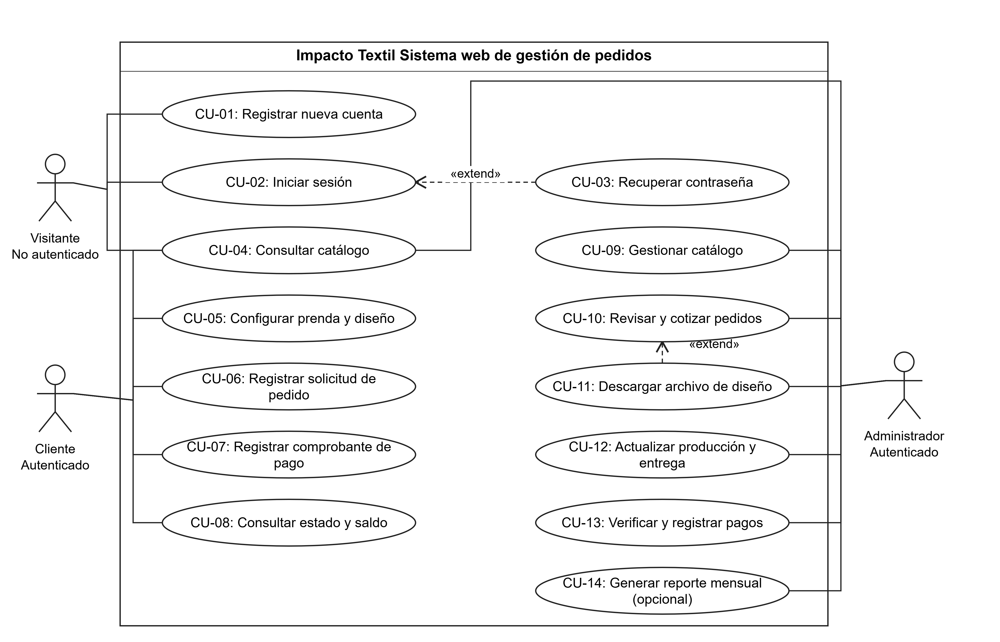
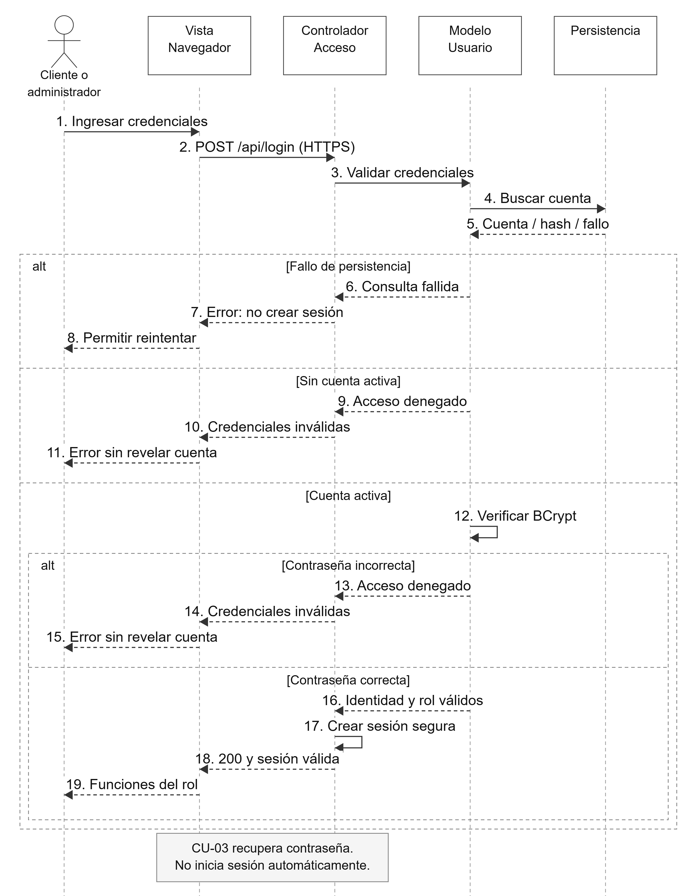
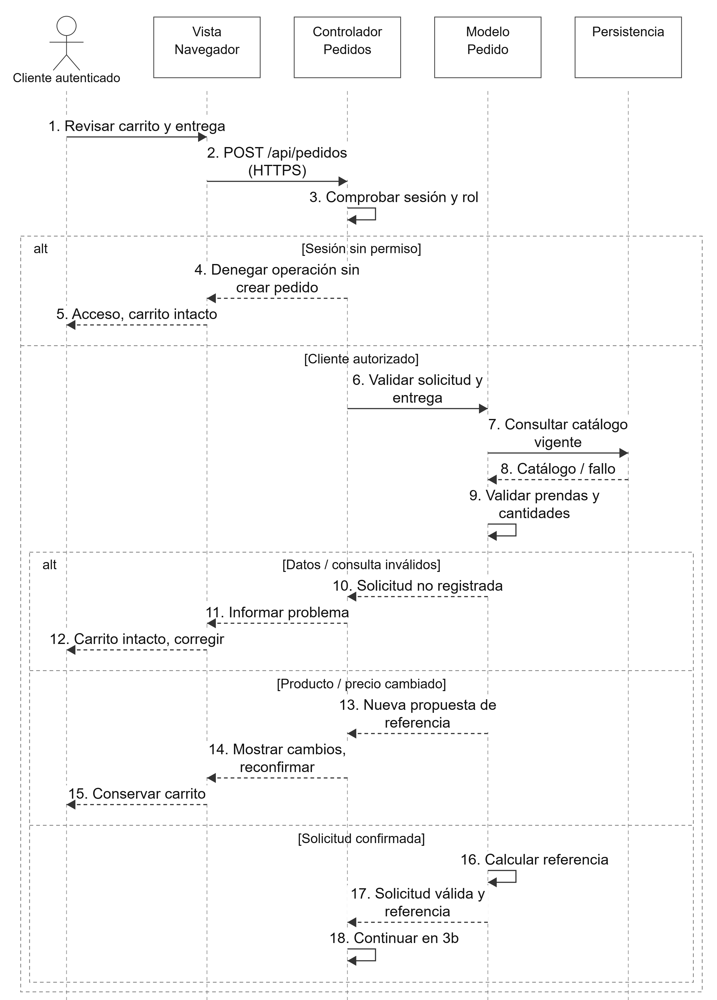
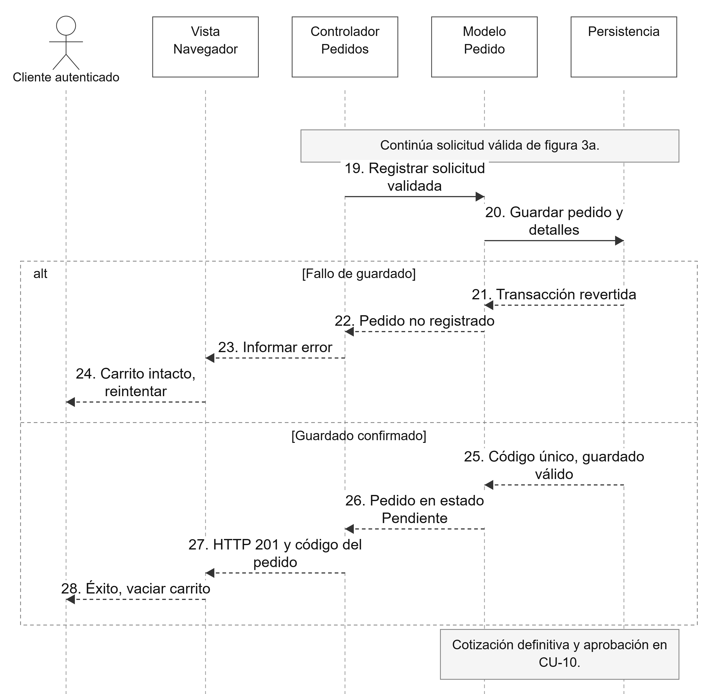
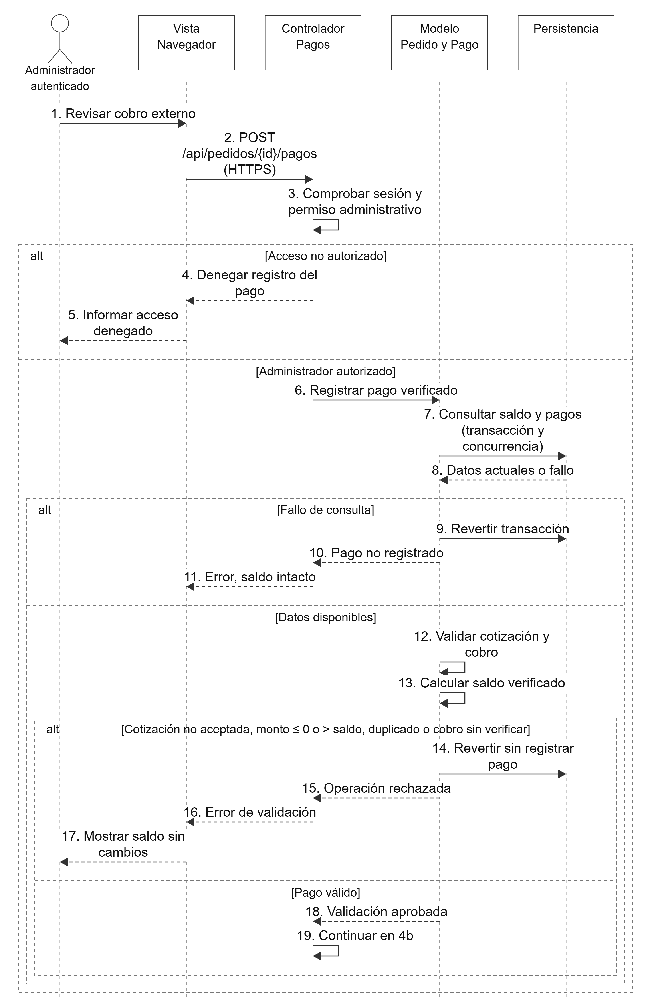
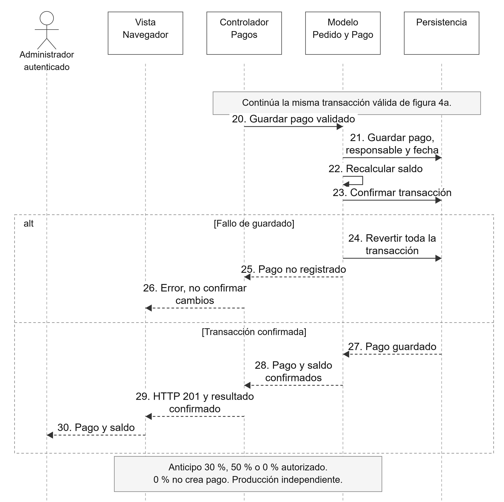
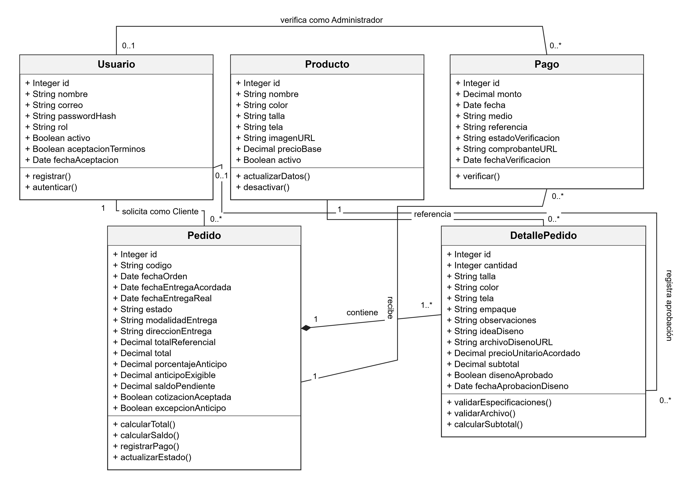

<!-- Convertido automáticamente desde "Fase 1 y 2 ing de software.docx". Revisar contra el original. -->

Área del Conocimiento de Tecnología de la

Información y la Comunicación

Programa Académico de Ingeniería de Sistemas

Aplicación de la 1ra fase y 2da fase de Análisis para la Empresa “Impacto Textil”

Ingeniería de software

| Elaborado por: |  |  | Tutor: |
|---|---|---|---|
| Yirardy Alberto Quintero Salamanca | Dylan Hernán Ruiz Romero | Carlos Tobías Borrell Saballos | Lic. Walter Quintero |
|  |  |  |  |

> [!NOTE]
> Tabla con celdas combinadas en el original; "〃" = celda combinada verticalmente.

Grupo: 3M4-SIS-S

Fecha: 14 de septiembre del 2026

## Aplicación de la 1ra fase de Análisis para la Empresa "Impacto Textil"

### 1. Acta de Constitución del Proyecto (Project Charter)

#### 1.1 Situación Problemática

Actualmente, el emprendimiento 'Impacto Textil' maneja la recepción de pedidos de camisetas personalizadas y básicas mediante canales de mensajería informal (WhatsApp, Facebook Messenger). Este enfoque manual genera una serie de problemas operativos y de atención al cliente. En primer lugar, la información de los pedidos se fragmenta; detalles críticos como tallas, colores, cantidades y, sobre todo, los archivos de diseño para la sublimación suelen perderse en el historial del chat o sufren compresión de calidad.

Además, el seguimiento de los abonos y pagos es desorganizado, requiriendo que el administrador revise manualmente capturas de pantalla de transferencias para confirmar un pedido. Esto provoca retrasos en la producción, errores en la confección de prendas (por ejemplo, sublimar un diseño en la talla equivocada) y una experiencia de usuario frustrante, lo que limita la capacidad de escalabilidad del negocio ante un aumento de demanda.

#### 1.2 Justificación de la Solución (Plataforma Web)

Para solucionar esta problemática, se propone el desarrollo de una Aplicación Web integral (Frontend, Backend y Base de Datos). Una solución 100% web centraliza toda la operación en un único sistema accesible desde cualquier navegador, eliminando la dependencia de la mensajería instantánea para la toma de pedidos.

El cliente podrá autogestionar su solicitud, subir sus diseños en alta resolución, seleccionar especificaciones exactas (talla, color, tipo de cuello) y subir su comprobante de pago en un entorno controlado. Para la administración, esto se traduce en un panel (Dashboard) organizado donde el estado de cada pedido fluye de forma estructurada (Pendiente, En Producción, Listo para Entrega), reduciendo los errores humanos a casi cero e incrementando la productividad del área de sublimación.

#### 1.3 Objetivos del Proyecto

Objetivo General:

Desarrollar e implementar una aplicación web transaccional para la gestión automatizada de pedidos de camisetas personalizadas por sublimación en Impacto Textil, mejorando la organización de la producción y la experiencia de compra del cliente en un plazo alineado al ciclo académico de 14 semanas.

Objetivos Específicos (SMART):

- Diseñar un catálogo digital interactivo que permita a los usuarios visualizar opciones de prendas básicas y subir recursos gráficos personalizados, logrando que el 100% de los pedidos ingresen estandarizados (Línea base: actualmente el 0% de los pedidos están estandarizados en formato, ya que se reciben como texto libre y fragmentado en WhatsApp).

- Implementar un módulo de gestión de órdenes (Dashboard) para el administrador que reduzca el tiempo de procesamiento y revisión de pedidos en un 60% (Línea base: el proceso manual actual de cruzar cuadernos, pagos y descargas toma un promedio estimado de 15 minutos por pedido).

- Desarrollar un sistema de autenticación y perfiles de usuario que permita a los clientes consultar el estado en tiempo real de sus pedidos, disminuyendo las consultas de soporte por WhatsApp en un 80% (Línea base: actualmente se reciben en promedio entre 3 a 5 mensajes por cliente únicamente para consultar el avance del pedido).

#### 1.4 Alcance del Producto (MVP)

El Producto Mínimo Viable (MVP) INCLUYE:

- Registro e inicio de sesión de usuarios (Clientes y Administrador).

- Catálogo de camisetas básicas (tallas, colores, precios).

- Módulo para subir archivos de diseño (imágenes/vectores) para sublimación.

- Carrito de compras y generación de orden de pedido.

- Módulo de carga de comprobantes de pago (transferencias/depósitos) y registro de anticipos/saldos (30%/50%).

- Panel de administración (CRUD de productos, cambio de estado de pedidos).

El Producto Mínimo Viable (MVP) NO INCLUYE:

- Pasarela de pagos con tarjeta de crédito/débito nativa (se manejará por transferencia manual validada por el admin).

- Módulo de facturación electrónica contable.

- Integración de logística de envíos externos (ej. integraciones con APIs de delivery).

- Gestión de inventario de materia prima (se mantiene producción bajo demanda).

Restricciones del Proyecto (Explícitas):

- Plazo: El tiempo límite de desarrollo e implementación es de 14 semanas (acorde al ciclo del curso).

- Plataforma: El sistema debe ser una plataforma 100% web, sin aplicaciones móviles nativas.

- Infraestructura: Límite máximo de carga de 10MB por archivo de diseño fotográfico/vectorial para no saturar el servidor.

#### 1.5 Stakeholders Clave

| Rol | Descripción | Interés/Expectativa |
|---|---|---|
| Patrocinador (Propietario Impacto Textil) | Dueño del emprendimiento, financia el proyecto. | Incrementar ventas, reducir mermas por errores, control total. |
| Administrador del Sistema | Encargado de revisar pedidos y pasarlos a producción. | Interfaz rápida, validación fácil de pagos, acceso a diseños en alta calidad. |
| Usuario Final (Cliente) | Persona que solicita camisetas. | Proceso de compra fácil, saber el estado de su pedido sin tener que preguntar. |
| Equipo de Desarrollo | Estudiantes de Ingeniería de Sistemas. | Cumplir con los requerimientos técnicos y aprobar la asignatura. |
| Evaluador (Docente) | MSc. Walter José Quintero Acevedo. | Evaluar el cumplimiento riguroso de los requerimientos técnicos, documentales y metodológicos del curso. |

#### 1.6 User Personas (Perfiles de Usuario)

User Persona 1: Cliente Frecuente (Eventos Sociales)

Nombre: Carlos Martínez | Edad: 28 años | Ocupación: Asesor Comercial / Organiza actividades familiares y con amigos.

- Perfil Tecnológico/Digital: Usa su Smartphone a diario para redes sociales y banca móvil. Está acostumbrado a comprar en tiendas en línea y prefiere páginas web claras donde pueda hacer su pedido rápido, sin tener que esperar a que le respondan por chat.

- Objetivos: Comprar grupos pequeños de camisetas (ej. 4 o 5) para cumpleaños, viajes familiares o retiros. Quiere poder entrar al catálogo, seleccionar las tallas y colores de cada persona, y subir la foto o diseño directamente sin dar tantas explicaciones.

- Frustraciones: Se desespera cuando tiene que escribir por WhatsApp la lista interminable de qué talla y color es para cada quién, porque a veces el negocio se confunde. Teme que la foto familiar o la imagen que envió se imprima borrosa porque WhatsApp le bajó la calidad.

User Persona 2: Cliente Ocasional (Regalo Personalizado)

Nombre: Valeria Somarriba | Edad: 22 años | Ocupación: Estudiante Universitaria.

- Perfil Tecnológico/Digital: Navega casi exclusivamente desde su Smartphone. Sus canales de comunicación preferidos son Instagram, TikTok y WhatsApp. Nivel tecnológico promedio; requiere interfaces sumamente intuitivas y altamente visuales.

- Objetivos: Comprar 1 o 2 camisetas con un diseño muy específico (fotos, frases) para cumpleaños o eventos. Saber exactamente cuándo estará lista la camiseta para recogerla.

- Frustraciones: Miedo a que la talla no sea la correcta porque no hay una guía visual en el chat. Ansiedad por no saber si su pago por transferencia fue verificado por el negocio.

1.7 Equipo del proyecto y roles

Patrocinadores (clientes):

Martha Isabel Quintero Fuentes

Oswaldo Mojica Mojica Chinchilla

Equipo de desarrollo (analistas):

Carlos Tobías Borrell Saballos

Yirardy Alberto Quintero Salamanca

Dylan Hernán Ruiz Romero

Evaluador:

MSc. Walter Jose Quintero Acevedo

1.8 Hitos del proyecto (cronograma de entregas)

Hito 1(fase 1- Requerimientos y Viabilidad): Semana del 07 al 12 de septiembre del 2026

Hito 2(fase 2- Análisis lógico y SRS): Semana del 06 al 11 de Octubre del 2026

Hito 3(fase 3 y 4 – Diseño, código funcional y defensa): Semana del 04 al 07 de Noviembre del 2026

1.9 Supuesto del proyecto

- Se asume que "Impacto Textil" cuenta con al menos un dispositivo (computadora o smartphone) y conexión a internet estable durante todo el periodo de desarrollo, necesarios para operar el panel administrativo del sistema.

- Se asume que las políticas de las capas gratuitas ("Free/Hobby Tier") de los proveedores cloud propuestos (Vercel, Azure App Service, Supabase/Azure SQL Edge) se mantendrán disponibles sin costo durante el semestre académico, tal como se planteó en la Viabilidad Económica.

- Se asume que el catálogo base de productos (tipos de camiseta, tallas y colores) se mantiene estable durante el desarrollo del MVP; una ampliación significativa del catálogo implicaría reevaluar el alcance definido en la sección 1.4.

- Se asume que el proceso de pago continuará gestionándose por transferencia o depósito bancario fuera del sistema, tal como ocurre actualmente; el MVP únicamente registra y almacena el comprobante adjunto, sin integrar una pasarela de pago en línea.

- Se asume que el cliente (o, en su defecto, el docente como aprobador sustituto) estará disponible para revisar y validar los avances en cada uno de los tres hitos de entrega definidos en la sección 1.8.

- Se asume que los datos recopilados durante la Fase 1 (entrevista y viabilidad) siguen siendo válidos y no requieren una nueva ronda de levantamiento antes de iniciar la Fase 2.

### 2. Documento de Viabilidad (Estudio de Factibilidad)

#### 2.1 Viabilidad Técnica

Para garantizar un desarrollo ágil y mantener un alto nivel de integridad en los datos, se establece la siguiente infraestructura técnica para la construcción del sistema:

Frontend (Capa de Presentación): Construido con HTML5, CSS3 y JavaScript. Asegura que el catálogo digital sea sumamente ligero, interactivo y completamente responsivo.

Backend (Capa de Lógica de Negocio): Desarrollado en C#. Gestiona de manera eficiente la lógica de estados de los pedidos y la seguridad del sistema.

ORM y Base de Datos: Entity Framework Core con SQL Server para manejar esquemas relacionales estrictos y garantizar la integridad pedido-cliente-producto.

Control de Versiones: GitHub Desktop con Visual Studio como IDE.

Análisis Explícito: Servidor Propio vs. Cloud

Se evaluó la alternativa de alojar el sistema en un servidor propio físico versus infraestructura Cloud. Un servidor propio exigiría una alta inversión inicial (CAPEX) en hardware, licencias (Windows Server/SQL Server) y adecuación de red local, además de personal para mantenimiento; lo cual es desproporcionado e inviable para el flujo actual del negocio. Por el contrario, la infraestructura Cloud (PaaS/DBaaS) elimina los costos de mantenimiento de hardware, ofrece escalabilidad automática ante picos de ventas y permite iniciar con capas gratuitas ("Hobby Tiers"), alineándose a la perfección con la solicitud expresa del cliente (Entrevista P40) de buscar opciones sin costo inicial.

#### 2.2 Viabilidad Económica

El proyecto es económicamente viable. Atendiendo a la solicitud directa del cliente (Entrevista P40) de iniciar con una opción gratuita, se ha estructurado una infraestructura basada en capas "Hobby" (Free Tiers) que conectan con esta preferencia comercial.

| Concepto | Descripción | Costo Estimado |
|---|---|---|
| Hosting Frontend | Vercel / Netlify (Hobby Tier) | C$0.00 / mensual |
| Hosting Backend | Azure App Service (F1) / Render (Free Tier) | C$0.00 / mensual |
| Base de Datos | Supabase / Azure SQL Edge (Free Tier) | C$0.00 / mensual |
| Dominio | Dominio .ni o .com | C$660 al año |
| Costo de Desarrollo (CAPEX / Horas-Hombre) | Desarrollo del MVP por el equipo técnico estudiantil. | C$0.00 para la empresa |
| Total Operativo | Mantenimiento base mensual (escenario inicial optimizado) | C$ 55.00 mensuales (solo se asume el costo anual del dominio de C$660) |

#### 2.3 Viabilidad Operativa

El personal actual tiene experiencia práctica en plataformas digitales (redes sociales, banca en línea), por lo que la curva de aprendizaje para un Dashboard administrativo intuitivo será mínima. Los clientes nicaragüenses ya están acostumbrados al e-commerce desde el celular.

#### 2.4 Viabilidad Legal

El sistema recopilará datos sensibles de los usuarios (Nombres completos, números de teléfono, correos electrónicos y direcciones para posibles entregas). Por ende, es de carácter obligatorio el cumplimiento de la Ley 787 de Nicaragua ('Ley de Protección de Datos Personales'). Para garantizar este cumplimiento, la aplicación web incorporará mecanismos concretos:

- Una casilla obligatoria de 'Aceptación de Términos, Condiciones y Política de Privacidad' en el formulario de registro.

- Protocolos de ciberseguridad: Las contraseñas en la base de datos (SQL Server) no se guardarán en texto plano, sino hasheadas utilizando algoritmos robustos manejados desde el backend en C# (BCrypt).

- Certificado SSL (HTTPS) obligatorio para cifrar la transferencia de las imágenes y comprobantes de pago en tránsito.

### 3. Product Backlog Inicial

| ID | Épica | Historia de Usuario | Prioridad | Justificación de Prioridad | Origen (Entrevista) |
|---|---|---|---|---|---|
| HU-01 | Gestión de Usuarios | Como cliente, quiero registrarme con mi correo y contraseña, para tener una cuenta en el sistema. | Must have | Esencial para vincular pedidos a clientes únicos. | P36 (Gestión de clientes) |
| HU-02 | Gestión de Usuarios | Como cliente, quiero iniciar sesión, para acceder a mi historial de pedidos. | Must have | Requisito de seguridad obligatorio para acceder a datos privados. | P36 |
| HU-03 | Catálogo | Como cliente, quiero ver los tipos de camisetas básicas disponibles en el catálogo digital, para elegir la base de mi diseño | Must have | Core business: sin catálogo no hay inicio de compra. | P36 (Catálogo digital) |
| HU-04 | Catálogo | Como cliente, quiero ver el detalle de una camiseta (precio, tallas), para saber cuánto me costará. | Must have | Información vital para la toma de decisión del cliente. | P15, P36 |
| HU-05 | Pedidos y Sublimación | Como cliente, quiero subir una imagen desde mi dispositivo, para que sea el diseño sublimado en mi camiseta. | Must have | Acción principal que resuelve el dolor de "archivos por WhatsApp". | P6 (Diseño propio) |
| HU-06 | Pedidos y Sublimación | Como cliente, quiero agregar especificaciones de texto u observaciones, para guiar la confección. | Should have | Importante para evitar errores, pero el diseño gráfico es la guía principal. | P7 |
| HU-07 | Carrito de Compras | Como cliente, quiero agregar mi camiseta personalizada al carrito, para agrupar múltiples pedidos. | Must have | Funcionalidad transaccional obligatoria del MVP. | P36 |
| HU-08 | Pagos | Como cliente, quiero subir un comprobante de transferencia (foto/PDF), para confirmar mi pago. | Must have | Única forma de validar transacciones sin pasarela nativa. | P28 (Depósitos) |
| HU-09 | Panel Admin | Como administrador, quiero ver una lista de todos los pedidos entrantes, para procesarlos. | Must have | Core operativo para organizar el trabajo del negocio. | P8, P35 (Registro) |
| HU-10 | Panel Admin | Como administrador, quiero descargar el archivo de diseño del cliente, para mandarlo a la máquina de sublimación. | Must have | Vital para completar la producción física de la camiseta. | P6 |
| HU-11 | Panel Admin | Como administrador, quiero cambiar el estado de un pedido (Pendiente -> Producción), para llevar el control. | Must have | Sustituye el cuaderno físico y organiza el flujo de trabajo. | P22, P23 |
| HU-12 | Notificaciones | Como cliente, quiero ver el estado actualizado de mi pedido, para saber cuándo recogerlo. | Should have | Mejora significativamente la experiencia y reduce soporte, pero el negocio puede operar sin él. | P26 |
| HU-13 | Gestión de Usuarios | Como cliente, quiero recuperar mi contraseña vía correo, para acceder si la olvido. | Should have | Práctica estándar de usabilidad, aunque el administrador podría resetearla manualmente. | Estándar web |
| HU-14 | Panel Admin | Como administrador, quiero agregar y gestionar (CRUD) los productos y colores del catálogo, para mantenerlo actualizado. | Must have | El MVP incluye gestión de catálogo; sin esto el sistema queda estático. | P19, P36 |
| HU-15 | Reportes | Como administrador, quiero ver un reporte mensual de ventas, para analizar mis ingresos. | Could have | Deseable para crecimiento futuro, pero no crítico para el flujo diario del MVP. | P36 |
| HU-16 | Pagos / Admin | Como administrador, quiero registrar y verificar los anticipos (30% o 50%) y saldos pendientes, para llevar el control contable exacto. | Must have | Regla de negocio crítica detectada en campo; el negocio no opera solo con pagos 100% de contado. | P29, P30 (Anticipos) |

### 4. Matriz de Trazabilidad y Requerimientos

| Req. ID | Descripción del Requerimiento | Tipo (FURPS+) | HU Asociada | Prioridad | Criterio de Verificación |
|---|---|---|---|---|---|
| RF-01 | El sistema debe permitir el registro de usuarios con email y contraseña. | Funcional | HU-01 | Alta | Creación exitosa del registro en la base de datos SQL Server. |
| RF-02 | El sistema debe permitir iniciar sesión verificando las credenciales. | Funcional | HU-02 | Alta | Acceso al sistema permitido con credenciales correctas. |
| RF-03 | El sistema debe mostrar un catálogo interactivo con imágenes, tallas y precios. | Funcional | HU-03, HU-04 | Alta | Listado de productos cargado exitosamente desde la tabla Productos. |
| RF-04 | El sistema debe permitir cargar archivos de imagen (.png, .jpg) hasta 10MB. | Funcional | HU-05 | Alta | El archivo se guarda en el servidor; el sistema arroja error si pesa >10MB. |
| RF-05 | El sistema debe generar un código de pedido único al procesar el carrito. | Funcional | HU-07 | Alta | ID alfanumérico autogenerado vinculado a la cuenta del cliente. |
| RF-06 | El sistema debe calcular el total de la orden según cantidad y tipo de prenda. | Funcional | HU-07 | Alta | Cálculo matemático exacto (Precio Base x Cantidad) mostrado en UI. |
| RF-07 | El sistema debe permitir adjuntar y almacenar el comprobante de transferencia. | Funcional | HU-08 | Alta | El archivo del comprobante es accesible y visible por el administrador. |
| RF-08 | El panel administrativo debe listar todos los pedidos y permitir filtrarlos. | Funcional | HU-09 | Alta | Tabla renderizada correctamente con opciones de filtrado por estado. |
| RF-09 | El sistema debe permitir al admin descargar el archivo original subido por el cliente. | Funcional | HU-10 | Alta | Descarga del archivo en resolución original sin corrupción. |
| RF-10 | El sistema debe permitir al admin actualizar el estado de una orden. | Funcional | HU-11 | Alta | El cambio de estado (ej. Pendiente a Producción) se refleja en la BD. |
| RF-11 | El sistema debe permitir el registro de anticipos (30%/50%) y calcular saldo pendiente. | Funcional | HU-16 | Alta | Operación aritmética: Saldo Pendiente = Total - Anticipo. |
| RF-12 | El sistema debe mostrar al cliente el estado actual y saldo pendiente de su pedido. | Funcional | HU-12 | Media | Los datos mostrados al cliente coinciden con los actualizados por el admin. |
| RF-13 | El sistema debe enviar un enlace o token para la recuperación de contraseña. | Funcional | HU-13 | Media | Recepción exitosa del correo de recuperación en la bandeja del usuario. |
| RF-14 | El panel debe permitir realizar el CRUD completo de productos del catálogo. | Funcional | HU-14 | Alta | Nuevos productos o colores agregados son visibles de inmediato en la tienda. |
| RF-15 | El sistema debe de permitir al cliente ingresar texto con observaciones o especificaciones adicionales durante el pedido | Funcional | HU-06 | Media | El texto se guarda en la base de datos y se muestra correctamente en el detalle del pedido administrativo |
| RF-16 | El sistema debe de generar un reporte mensual consolidado de ventas y pedidos completados | Funcional | HU-15 | Baja | Visualización de sumatorias de ventas filtradas por mes en el panel del administrador. |
| RNF-01 | La interfaz debe ser Responsiva y adaptarse a móviles (resolución mínima de 320px). | Usabilidad | Todas | Alta | Visualización óptima al 100% sin necesidad de desplazamiento (scroll) horizontal en pantallas de 320px. |
| RNF-02 | El tiempo de respuesta al subir una imagen debe ser menor a 3 segundos. | Rendimiento | HU-05 | Media | Pruebas de latencia (Network tab) promedian menos de 3000ms. |
| RNF-03 | Las contraseñas deben estar encriptadas mediante algoritmo BCrypt en la DB. | Seguridad | HU-01 | Alta | Revisión directa en BD demuestra hashes en lugar de texto plano. |
| RNF-04 | El sistema debe cumplir con la Ley 787 de protección de datos (Términos y SSL). | Legal (+) | HU-01 | Alta | Candado de seguridad HTTPS activo en el navegador. |
| RNF-05 | El sistema debe soportar al menos 50 usuarios concurrentes sin degradación. | Escalabilidad | Todas | Media | Pruebas de estrés (ej. JMeter) superadas manteniendo tiempos de respuesta. |
| RNF-06 | El sistema debe tener un uptime mensual del 99%. | Disponibilidad | Todas | Media | Reporte de métricas del servidor (Azure/Render) confirma el uptime. |

### Conclusión General de la Fase 1

Con la documentación aquí generada (Acta de Constitución, Estudio de Viabilidad, Backlog Ágil y Matriz de Requerimientos), se concluye el entendimiento del problema de negocio para Impacto Textil. Bajo la metodología de evaluación por dimensiones, se emiten los siguientes veredictos condicionales:

- Viabilidad Técnica: APROBADA, dada la selección de tecnologías maduras y compatibles (C#, EF Core, SQL Server) y una infraestructura basada en Cloud que elimina la dependencia de hardware local.

- Viabilidad Económica: APROBADA, ya que la arquitectura Cloud propuesta aprovecha capas gratuitas (Free Tiers), reduciendo el costo operativo mensual a cero y limitando la inversión únicamente al dominio anual (C$ 660), cumpliendo la expectativa del cliente.

- Viabilidad Operativa: APROBADA, respaldada por la alfabetización digital preexistente tanto del equipo administrativo como del segmento de clientes, lo que garantiza una curva de adopción rápida.

- Viabilidad Legal: APROBADA CONDICIONADA a la implementación técnica y estricta del protocolo HTTPS, el cifrado BCrypt y la obligatoriedad en la aceptación de términos, garantizando el cumplimiento de la Ley 787.

Por consiguiente, el proyecto se encuentra formalmente justificado y listo para iniciar la Fase 2: Modelado Lógico y la Especificación de Requerimientos de Software .

Anexos

Instrumento: Entrevista

Información general

Negocio: Impacto Textil — confección de camisetas personalizadas y básicas por sublimación

Persona entrevistada: Martha Isabel Quintero Fuentes (propietaria)

Cargo: Propietaria

Ubicación: Masatepe, Masaya, Nicaragua

Entrevistadores: Yirardy Quintero · Dylan Ruiz · Carlos Borrell

Bloque A — Recepción de pedidos

1. ¿Cómo reciben actualmente los pedidos de camisetas?

Respuesta: Mediante un modelo mixto: WhatsApp Business como canal principal para cotizar, enviar modelos de muestra, confirmar pedidos y coordinar entregas, y atención presencial en una sección habilitada en la casa de los dueños para clientes que prefieren ver el producto antes de comprar.

2. ¿Los clientes hacen el pedido físicamente, por WhatsApp, Facebook, Instagram u otro medio?

Respuesta: Por varios medios: WhatsApp (para cotizar y cerrar el pedido), redes sociales como Instagram, Facebook (donde el cliente descubre el producto y luego es dirigido a WhatsApp), y de forma presencial en el local.

3. ¿Cuál de estos medios utilizan con mayor frecuencia?

Respuesta: WhatsApp Business. El plan de marketing lo describe como el "canal de cierre": una vez el cliente ve la publicidad en redes sociales, el paso natural siguiente es contactar por WhatsApp para cotizar y hacer el pedido.

4. ¿Qué información solicitan al cliente cuando hace un pedido?

Respuesta: El diseño o idea (frase, imagen de referencia, personaje o fotografía), talla, color, cantidad de camisetas y tipo de empaque deseado (bolsa estándar o caja premium); con esa información se asesora al cliente y se elabora la cotización.

Bloque B — Diseños y personalización

5. ¿Cómo muestran los diseños disponibles a los clientes?

Respuesta: A través de fotos y videos publicados en Instagram, Facebook (incluyendo el proceso de sublimación y el "unboxing" del empaque), y mediante el envío de un mockup (vista previa del diseño) por WhatsApp antes de sublimar.

6. ¿El cliente puede enviar su propio diseño?

Respuesta: Sí. El cliente puede expresar su idea o enviar una imagen de referencia; el negocio asesora sobre el diseño, sugiere mejoras y cotiza según la complejidad.

7. ¿Cómo se especifican las características de la camiseta (talla, color, cantidad, ubicación del estampado)?

Respuesta: Se definen durante la etapa de cotización y diseño por WhatsApp: el cliente indica sus preferencias y el negocio asesora sobre diseño, colores, tipografías y tipo de empaque, enviando después un mockup para su aprobación antes de sublimar.

Bloque C — Registro de pedidos

8. ¿Cómo registran actualmente un pedido?

Respuesta: Se registran mediante un cuaderno en el cual se registran las características del pedido, al cliente y fecha de entrega.

9. ¿Usan cuaderno, Excel, WhatsApp, hojas impresas u otro medio?

Respuesta: Uso de cuaderno

10. ¿Qué información contiene el registro de un pedido?

Respuesta: Las características de la prenda, precio, fecha de entrega y el nombre del cliente

11. ¿Qué sucede cuando un cliente modifica un pedido después de haberlo hecho?

Respuesta: Si la prenda aún está siendo confeccionada aun, se puede realizar ciertos cambios, como el diseño de la sublimación sin embargo una vez escogido la tela y el color de esta misma no se puede cambiar más.

Bloque D — Registro de clientes

12. ¿Llevan actualmente un registro de clientes?

Respuesta: No del todo o no de manera profesional ni con un orden lógico solo se apuntan el cliente, pedido con el precio de la prenda y fecha de entrega del producto.

13. ¿Qué datos guardan de cada cliente?

Respuesta: Únicamente el nombre de ese cliente

14. ¿Pueden consultar fácilmente pedidos anteriores de un cliente?

Respuesta: No del todo solo buscando entre medio de los registros.

Bloque E — Cálculo del precio

15. ¿Cómo calculan el precio de un pedido?

Respuesta: Combinando tres enfoques principales: costos de producción (insumos y mano de obra ≈ C$98.30 por camiseta sin empaque), comparación con los precios de la competencia (C$200–C$400) y un empaque llamativo como una bolsa o una caja. El resultado son dos precios que oscilan entre:C$250 Y C$350 dependiendo de la complejidad del pedido.

16. ¿Qué factores influyen en el precio (cantidad, talla, tipo de tela, diseño)?

Respuesta: Principalmente la cotización también considera la complejidad del diseño también el tipo de empaque (bolsa o caja). La base del costo variable incluye tela, hilos, agujas, tinta de sublimación, hoja de sublimación y mano de obra de corte y confección.

17. ¿El precio se calcula manual o automáticamente?

Respuesta: De forma manual. No se menciona ninguna herramienta o sistema automatizado para calcular el precio de un pedido.

Bloque F — Inventario

18. ¿Cómo controlan actualmente el inventario?

Respuesta: El negocio no tiene un orden especifico en su inventario, la materia prima se compra al momento de obtener un pedido

19. ¿Qué controlan (camisetas, tallas, colores, insumos de sublimado)?

Respuesta: Camisetas (poliéster o algodón + poliéster), tintas de sublimación, papel transfer/hoja de sublimación, hilos, agujas, y los dos tipos de empaque (bolsa estándar y caja premium).

20. ¿Han tenido problemas por falta de inventario o por no saber cuánto tienen disponible?

Respuesta: Si cuando los pedidos son requeridos en un corto periodo de tiempo la necesidad de comprar la materia prima se convierte en la máxima prioridad para la confección de la camiseta, además de que el cliente debe de realizar su pedido con anticipación para confirmar su pedido.

Bloque G — Pedidos pendientes

21. ¿Cómo saben qué pedidos están pendientes?

Respuesta: Se revisa el cuaderno donde están apuntados sin embargo no existe algo automático que nos permita saber que pedidos están pendientes.

22. ¿Cómo controlan el estado de cada pedido (recibido, en producción, terminado, entregado)?

Respuesta: El proceso de producción sigue una secuencia lineal (selección de materia prima → corte → costura → inspección → diseño/sublimación → acabados → empaque → almacenamiento), pero no se controla de forma directa el estado del pedido es por eso que hay una fecha de entrega del producto.

23. ¿Han tenido problemas por olvidar o retrasar algún pedido?

Respuesta: No realmente, ya que impacto textil esta comprometido con una entrega hábil.

Bloque H — Entrega

24. ¿Cómo se realiza la entrega de las camisetas?

Respuesta: Por entrega a domicilio en Masatepe y zonas cercanas (coordinada por WhatsApp) o por retiro personal en el lugar.

25. ¿Entregan a domicilio o el cliente retira el pedido?

Respuesta: Ambas opciones están disponibles: entrega a domicilio o retiro en el lugar.

26. ¿Cómo registran que un pedido ya fue entregado?

Respuesta: Por confirmación del mismo cliente ya sea mediante envio o por retiro personal del cliente

Bloque I — Pagos

27. ¿Cómo realizan los clientes los pagos?

Respuesta: Depósitos, en efectivo y tarjeta.

28. ¿Aceptan efectivo, transferencia, depósito u otros medios?

Respuesta: Únicamente efectivo, trasferencia, deposito y por tarjeta.

29. ¿Se solicita anticipo para comenzar un pedido?

Respuesta: En pedidos de gran volumen un 50% de anticipo mientras que en pedidos unitarios un 30%, aunque pocas veces únicamente por el reconocimiento hacia el cliente un 0% de anticipo.

30. ¿Cómo registran los pagos y saldos pendientes?

Respuesta:  El registro de pagos y saldos pendiente se logran visualizar mediante un cuaderno con anotaciones que se chequean comúnmente al finaliza la semana ,

Bloque J — Problemas actuales y mejoras deseadas

31. ¿Cuáles son los principales problemas para administrar los pedidos hoy?

Respuesta: A nivel comercial: recursos financieros limitados, falta de una estrategia solida o poca visión de marketing digital s, publicaciones esporádicas sin planificación y dependencia de pocos proveedores. A nivel operativo: ausencia de señalización de seguridad, falta de ventilación mecánica para el calor de la plancha de sublimación, no uso de equipo de protección personal y condiciones ergonómicas deficientes (mesas y sillas no ajustables).

32. ¿Qué actividades les consumen más tiempo?

Respuesta: Según el estudio de tiempos, el diseño y edición de imagen es la actividad con mayor tiempo estándar , junto con el del corte y preparación.

33. ¿Qué errores ocurren con mayor frecuencia?

Respuesta: Un mal corte, mala costura.

34. ¿Qué información les resulta difícil de encontrar cuando la necesitan?

Respuesta: Mayormente vendría siendo el color de tela que el cliente desea especialmente si se trata de colores poco comunes.

35. Si pudieran mejorar una sola parte del proceso actual, ¿cuál sería?

Respuesta: Mejorar el registro de los pedidos.

36. ¿Qué les gustaría que un sistema web pudiera hacer por ustedes?

Respuesta: un catálogo digital de productos accesible desde el celular (diseños, tallas, colores y precios), una página web básica con galería de productos, formulario de contacto y enlace directo a WhatsApp Business, y a mediano plazo un sistema de gestión de pedidos que automatice el registro de ventas, el control de inventario y el seguimiento de clientes, reduciendo la carga administrativa manual.

Bloque K — Viabilidad del negocio (apoyo a Dylan)

37. ¿Cuántas personas trabajan actualmente en el negocio, además de usted?

Respuesta: El negocio es atendido por dos personas, ambas dueñas: una encargada de la selección de materia prima, corte, costura e inspección, y otra encargada del diseño, impresión, sublimación, acabados, inspección final y empaque.

38. ¿Con qué frecuencia reciben pedidos (aprox. por semana o por mes)?

Respuesta: Volumen estimado de 25-50 camisetas al mes aproximadamente de forma unitaria sin contar grupos o equipos que necesiten de nuestros servicios.

39. ¿Cuentan con computadora, smartphone e internet estable en el negocio?

Respuesta: Sí. Cuentan con computadora e impresora especializada para el diseño y la sublimación, celular para WhatsApp Business y redes sociales, e internet en el local (registrado como costo fijo mensual de C$1,350 dentro del presupuesto).

40. ¿Estarían dispuestos a invertir en hosting/dominio para un sistema web, o buscan una opción gratuita?

Respuesta: De momento una opción gratuita que nos permita impulsarnos más ya después si es posible migrar a un dominio web que nos permita modernizarnos aún más.

41. ¿Emiten factura o algún comprobante de pago actualmente?

Respuesta: No, únicamente con un volumen grande de pedidos.

Bloque L — Cierre

42. ¿Existe alguna otra dificultad o necesidad importante que no hayamos preguntado?

Respuesta: Quizás cuando el negocio crezca contratar más personal para reducir cargas de trabajo.

Fase 2 Artefactos de análisis UML y SRS

1. Modelo de casos de uso UML

1.1 Actores del sistema

Visitante: persona sin sesión activa que consulta el catálogo y solicita registro, acceso o recuperación de contraseña. La autenticación es una condición de acceso a las operaciones privadas, no un rol de negocio.

Cliente: solicita cotizaciones y pedidos, aporta ideas, imágenes y comprobantes, y consulta sus propios estados y saldos. El administrador verifica los pagos; el cliente no acredita cobros.

Administrador: revisa y cotiza pedidos, gestiona el catálogo, registra aprobaciones y pagos verificados, y actualiza producción y entrega. Sus permisos se asignan de forma controlada.

Visitante representa a un usuario no autenticado. Cliente y Administrador representan los roles autorizados después de iniciar sesión; quien solicita CU-02 aún no tiene una sesión activa. El registro público asigna únicamente el rol Cliente.

1.2 Catálogo de casos de uso y relaciones

| ID CU | Nombre del Caso de Uso | Actor Principal | Relaciones UML (<<include>> / <<extend>>) |
|---|---|---|---|
| CU-01 | Registrar nueva cuenta | Visitante | Ninguna |
| CU-02 | Iniciar sesión | Cliente / Administrador sin sesión | Recibe <<extend>> de CU-03 en «solicitar recuperación». |
| CU-03 | Recuperar contraseña | Cliente / Administrador sin sesión | CU-03 <<extend>> CU-02 si se solicita recuperación. |
| CU-04 | Consultar catálogo de productos | Visitante, Cliente y Administrador | Ninguna |
| CU-05 | Configurar prenda y diseño | Cliente | Validación interna si se adjunta imagen; no es un objetivo independiente. |
| CU-06 | Registrar solicitud de pedido | Cliente | Sesión activa como precondición; sin <<include>> a CU-02. |
| CU-07 | Registrar comprobante de pago | Cliente | Ninguna |
| CU-08 | Consultar estado y saldo | Cliente | Ninguna |
| CU-09 | Gestionar catálogo | Administrador | Ninguna |
| CU-10 | Revisar y cotizar pedidos | Administrador | Recibe <<extend>> de CU-11 al solicitar descarga. |
| CU-11 | Descargar archivo de diseño | Administrador | CU-11 <<extend>> CU-10 si hay archivo y se solicita. |
| CU-12 | Actualizar producción y entrega | Administrador | Ninguna |
| CU-13 | Verificar y registrar pagos | Administrador | Cálculo del saldo como paso interno obligatorio. |
| CU-14 | Generar reporte mensual | Administrador | Función opcional del backlog; no condiciona el flujo principal. |

Figura 1. Diagrama de casos de uso del sistema Impacto Textil.

CU-03 extiende CU-02 cuando el usuario solicita recuperar la contraseña. CU-11 extiende CU-10 cuando el administrador solicita descargar un diseño existente. Las flechas «extend» parten del caso que añade el comportamiento y apuntan al caso base. CU-06 exige sesión previa. Validar archivos, comprobar permisos y calcular saldos son pasos internos, no casos de uso independientes; no se representan como «include» artificiales.

1.3 Especificaciones narrativas de casos de uso principales

CU-02: Iniciar Sesión

Actor principal: Cliente o Administrador sin sesión activa.

Resumen: El cliente o administrador inicia sesión para acceder a las funciones de su rol; el mismo usuario es el beneficiario.

Precondiciones: Cuenta registrada y activa; correo y contraseña disponibles.

Poscondiciones: Sesión creada solo si las credenciales son válidas; acceso limitado según rol.

Flujo principal:

1. El usuario solicita acceso.

2. Ingresa correo y contraseña.

3. El sistema busca la cuenta y verifica el hash.

4. Crea una sesión segura.

5. Muestra las funciones autorizadas.

Flujo alternativo: En el ingreso de credenciales, CU-03 extiende CU-02 si el usuario solicita recuperar la contraseña; el restablecimiento no inicia sesión automáticamente.

Excepciones: Credenciales inválidas: informar sin revelar datos de la cuenta. Fallo de persistencia: no crear sesión y permitir reintentar.

Excepción adicional: Cuenta inexistente o inactiva: denegar el acceso sin crear sesión. La recuperación debe mantener una respuesta neutral sobre la existencia de la cuenta.

CU-05: Configurar prenda y diseño

Actor principal: Cliente autenticado.

Resumen: El cliente define la prenda, el empaque y el diseño o idea para solicitar cotización; el cliente se beneficia del registro completo.

Precondiciones: Cliente autenticado y producto activo seleccionado.

Poscondiciones: Configuración guardada en el carrito; aún no implica cotización ni diseño aprobados.

Flujo principal:

1. Elegir talla, color, tela, cantidad y empaque.

2. Adjuntar JPG/PNG o describir la idea.

3. Validar los datos y, si existe archivo, su contenido y tamaño.

4. Guardar la configuración.

5. Confirmar al cliente.

Alternativas: Sin archivo, registrar la idea para asesoría. Observaciones adicionales opcionales. La vista previa se acuerda por WhatsApp y el administrador registra su aprobación antes de sublimar.

Excepciones: Imagen mayor de 10 MB o inválida: rechazarla. Datos incompletos: solicitar corrección. Sesión expirada: pedir nuevo acceso sin confirmar el guardado.

El límite de archivo es inclusivo: 10 MB = 10 000 000 bytes. Un archivo de ese tamaño se acepta si su contenido es válido; uno de 10 000 001 bytes se rechaza sin perder las especificaciones ya introducidas.

CU-06: Registrar solicitud de pedido

Actor principal: Cliente autenticado.

Resumen: El cliente envía el carrito para su revisión y cotización; obtiene un código para consultar su solicitud.

Precondiciones: Cliente autenticado y carrito con al menos un detalle válido.

Poscondiciones: Solicitud en estado Pendiente, vinculada al cliente; carrito vaciado solo tras confirmar el guardado.

Flujo principal:

1. Revisar carrito y modalidad de entrega.

2. Validar productos y cantidades.

3. Mostrar el importe de referencia.

4. Confirmar solicitud.

5. Guardar pedido y detalles con código único.

6. Informar éxito y vaciar carrito. CU-10 gestiona después la cotización definitiva.

Alternativa de acceso: Si no hay sesión, solicitar CU-02 antes de iniciar CU-06 y conservar el carrito. No se modela como inclusión condicional.

Excepciones: Producto inactivo o precio cambiado: informar, actualizar la propuesta y solicitar confirmación. Fallo de guardado: revertir la operación y conservar el carrito.

CU-10: Revisar y cotizar pedidos

Actor principal: Administrador autenticado.

Resumen: El administrador revisa solicitudes y acuerda precio, diseño y entrega con el cliente; ambos obtienen un pedido definido.

Precondiciones: Administrador autenticado y autorizado; pedido existente.

Poscondiciones: Cotización, fecha, modalidad de entrega y aprobaciones registradas. Revisar no equivale a autorizar producción ni a recibir un pago.

Flujo principal:

1. Listar y filtrar pedidos.

2. Revisar prendas, diseño y empaque.

3. Cotizar según complejidad y empaque.

4. Registrar aceptación del cliente y fecha acordada.

5. Registrar aprobación de la vista previa antes de sublimar.

6. Registrar el anticipo exigible o su excepción autorizada. CU-12 comprueba esas condiciones antes de iniciar producción.

Alternativas: CU-11 extiende CU-10 cuando se solicita descargar un archivo existente. Admitir cambios de diseño viables durante la confección; tela y color elegidos no cambian. Registrar aprobación de la nueva versión y, si varía el precio, una nueva cotización aceptada sin alterar los pagos registrados.

Excepciones: Datos insuficientes o cotización inicial no aceptada: mantener Pendiente. Una revisión durante producción no cambia automáticamente el estado. Fallo de consulta o guardado: informar sin confirmar cambios.

CU-13: Verificar y registrar pagos

Actor principal: Administrador autenticado.

Resumen: El administrador registra cobros externos verificados; el cliente y el negocio obtienen un saldo consistente.

Precondiciones: Administrador autorizado, cotización aceptada y evidencia del cobro verificada o constancia de recepción.

Poscondiciones: Pago registrado una sola vez y saldo recalculado; estado de pago separado del estado de producción.

Flujo principal:

1. Consultar de forma consistente el total aceptado y los pagos previos.

2. Verificar medio, referencia y monto.

3. Validar que el monto sea positivo y no supere el saldo; descartar duplicados.

4. Guardar el pago con su verificador y fecha, y recalcular el saldo en una única operación.

5. Confirmar el guardado. Saldo = total acordado − pagos verificados acumulados.

Alternativas: Anticipo exigible del 30 % en pedidos unitarios y 50 % en gran volumen; 0 % por autorización administrativa. Pago total: saldo cero. El umbral de gran volumen y la política para pedidos intermedios se acordarán antes de activar su clasificación automática.

Excepciones: Rechazar importes no positivos, superiores al saldo, duplicados o sin verificar. La excepción de 0 % se registra como autorización, no como un pago de importe cero.

Excepción de persistencia y concurrencia: Si falla el guardado, revertir el pago y el saldo. Si dos verificaciones compiten por el mismo saldo, revalidar con los pagos confirmados antes de aceptar cada una; ninguna puede duplicar el cobro ni producir saldo negativo.

CU-12: Actualizar producción y entrega

Actor principal: Administrador autenticado; el Cliente confirma la entrega al negocio.

Resumen: Registrar el avance autorizado del pedido y su entrega, conservando la separación entre producción y pagos.

Precondiciones: Pedido existente, administrador autorizado y transición válida. Para iniciar producción: cotización aceptada, diseño aprobado y anticipo verificado suficiente o excepción de anticipo autorizada.

Poscondiciones: Estado actualizado y comunicado en la consulta del cliente. Al marcar Entregado se registra la fecha real de entrega y la confirmación del cliente; los pagos se conservan.

Flujo principal:

1. Consultar el pedido y su estado actual.

2. Solicitar el siguiente estado de la secuencia Pendiente → En producción → Listo para entrega → Entregado.

3. Al iniciar producción, comprobar cotización, aprobación del diseño y anticipo exigible frente a pagos verificados, o la excepción autorizada.

4. Antes de sublimar, comprobar que la versión vigente del diseño tiene aprobación registrada.

5. Al marcar Entregado, registrar la confirmación del cliente y la fecha real de entrega.

6. Guardar el cambio y mostrar el mismo estado al administrador y al cliente.

Flujos alternativos: Un cambio de diseño viable se tramita en CU-10 con nueva aprobación y, si varía el precio, una nueva cotización aceptada. La excepción de anticipo del 0 % permite comprobar la autorización sin registrar un pago ficticio.

Excepciones: Rechazar transiciones fuera de la secuencia, inicio sin condiciones cumplidas, entrega sin confirmación, sesión expirada o falta de permisos. Ante fallo de guardado, mantener el estado anterior. El pago no cambia automáticamente la producción.

2. Modelado dinámico Secuencia MVC

Los tres recorridos muestran al usuario actuando sobre la Vista (Navegador), la petición HTTP por HTTPS al Controlador, la consulta y validación del Modelo y la respuesta. La persistencia colabora con el Modelo; el navegador no accede directamente a los datos. Se describen responsabilidades lógicas y resultados, sin código ni diseños de pantallas.

2.1 Secuencia de iniciar sesión CU-02

1. Usuario → Vista: Ingresa correo y contraseña.

2. Vista → Controlador: Envía la petición HTTP de acceso mediante HTTPS.

3. Controlador → Modelo: Solicita validar las credenciales.

4. Modelo → Persistencia: Consulta la cuenta por correo y recibe la cuenta, su hash, la ausencia de cuenta o un fallo.

5. Modelo: Comprueba que la cuenta esté activa y verifica la contraseña contra el hash BCrypt; no compara texto plano.

6. Modelo → Controlador: Devuelve identidad y rol únicamente con credenciales válidas.

7. Controlador: Crea una sesión segura y limita las operaciones al rol autorizado.

8. Controlador → Vista → Usuario: Informa éxito o denegación. Ante credenciales incorrectas, cuenta inactiva o fallo de persistencia, no crea sesión.

Figura 2. Diagrama de secuencia MVC de iniciar sesión.

2.2 Secuencia de registrar solicitud de pedido CU-06

1. Cliente → Vista: Confirma la solicitud con sesión activa y carrito no vacío.

2. Vista → Controlador: Envía la petición HTTP de registro mediante HTTPS.

3. Controlador: Comprueba la sesión y el rol Cliente antes de solicitar el registro al Modelo.

4. Modelo → Persistencia: Consulta los productos activos y sus opciones vigentes.

5. Modelo: Valida detalles, cantidades, archivos y modalidad de entrega. Si cambió un precio o producto, solicita una nueva confirmación y conserva el carrito.

6. Modelo: Calcula el importe de referencia. La cotización definitiva se acuerda posteriormente en CU-10.

7. Modelo → Persistencia: Guarda pedido y detalles con código único y estado Pendiente en una sola transacción.

8. Persistencia → Modelo → Controlador: Confirma el guardado; si falla, revierte la operación.

9. Controlador → Vista → Cliente: Devuelve confirmación de creación y código. El carrito se vacía solo después del éxito; ante rechazo o error se conserva.

Figura 3a. Secuencia MVC de registrar solicitud de pedido: validación.

Figura 3b. Continuación de la secuencia MVC: guardado y confirmación del pedido.

2.3 Secuencia de verificar y registrar pagos CU-13

1. Administrador → Vista: Revisa el cobro externo e ingresa los datos del pago verificado.

2. Vista → Controlador: Envía la petición HTTP de registro mediante HTTPS.

3. Controlador: Comprueba sesión y permisos administrativos; solicita registrar el pago al Modelo.

4. Modelo → Persistencia: Inicia una operación consistente y consulta cotización aceptada, total, pagos previos y referencias, controlando verificaciones concurrentes.

5. Modelo: Comprueba evidencia o recepción del cobro, monto positivo, monto no superior al saldo y ausencia de duplicados.

6. Modelo → Persistencia: Guarda el pago Verificado, el responsable y la fecha; recalcula saldo = total acordado − suma de pagos verificados.

7. Persistencia: Confirma todos los cambios juntos; ante rechazo o fallo, los revierte sin modificar pago ni saldo.

8. Modelo → Controlador → Vista → Administrador: Devuelve el pago confirmado y el saldo actualizado. No cambia automáticamente el estado de producción.

Figura 4a. Secuencia MVC de verificar pagos: permisos y validación.

Figura 4b. Continuación de la secuencia MVC: registro del pago y saldo.

Los diagramas incluyen ramas de credenciales inválidas o consulta fallida, datos de solicitud inválidos o precios cambiados y pago rechazado o guardado fallido. Una evidencia Pendiente o Rechazada no reduce el saldo. La excepción del 0 % es una autorización, no un pago de importe cero.

3. Modelo estático de análisis

3.1 Definición conceptual de clases

El modelo utiliza String, Integer, Date, Boolean y Decimal. Los importes requieren Decimal con dos decimales. El catálogo puede cambiar sin alterar especificaciones ni precios históricos del pedido. Date representa una fecha o una fecha y hora según el formato del diccionario; los límites de texto son reglas lógicas de validación, no tipos de una base de datos relacional.

Usuario: id: Integer; nombre, correo, passwordHash y rol: String; activo, aceptacionTerminos: Boolean; fechaAceptacion: Date. Operaciones lógicas: registrar y autenticar. Rol administrativo asignado de forma controlada; cada cliente consulta solo sus pedidos.

Producto: id: Integer; nombre, color, talla, tela e imagenURL: String; precioBase: Decimal; activo: Boolean. Operaciones lógicas: actualizarDatos y desactivar. El precio del catálogo es de referencia hasta aceptar la cotización.

Pedido: id: Integer; codigo: String; fechaOrden, fechaEntregaAcordada y fechaEntregaReal: Date; estado, modalidadEntrega y direccionEntrega: String; totalReferencial, total, porcentajeAnticipo, anticipoExigible y saldoPendiente: Decimal; cotizacionAceptada y excepcionAnticipo: Boolean. Operaciones lógicas: calcularTotal, calcularSaldo, registrarPago y actualizarEstado.

DetallePedido: id y cantidad: Integer; talla, color, tela, empaque, observaciones, ideaDiseno y archivoDisenoURL: String; precioUnitarioAcordado y subtotal: Decimal; disenoAprobado: Boolean; fechaAprobacionDiseno: Date. Operaciones lógicas: validarEspecificaciones, validarArchivo y calcularSubtotal.

Pago: id: Integer; monto: Decimal; fecha y fechaVerificacion: Date; medio, referencia, estadoVerificacion y comprobanteURL: String. Operación lógica: verificar. Cada pago se vincula a un Pedido por asociación; no se añaden claves foráneas al modelo conceptual.

Figura 5. Diagrama de clases de análisis de Impacto Textil.

3.2 Relaciones y multiplicidades

Usuario 1 — Pedido 0..*: cada Pedido pertenece a un único Usuario con rol Cliente; un cliente puede no tener pedidos o tener varios.

Pedido 1 ◆— DetallePedido 1..*: composición, con el rombo en Pedido. Cada detalle pertenece a un único pedido y no existe un pedido confirmado sin detalles.

Producto 1 — DetallePedido 0..*: cada detalle referencia un producto; un producto puede aparecer en varios pedidos. Desactivar el producto conserva esas referencias.

Pedido 1 — Pago 0..*: cada pago pertenece a un pedido; un pedido puede no tener pagos o acumular varios.

Usuario 0..1 — Pago 0..*: el usuario con rol Administrador registra la verificación. Un pago Pendiente puede carecer de verificador; uno Verificado debe tener responsable y fecha.

Usuario 0..1 — DetallePedido 0..*: el Administrador registra la aprobación comunicada por el cliente. Un detalle sin aprobar puede no tener responsable; uno aprobado debe tener responsable y fecha.

3.3 Reglas de negocio del dominio

1. El registro público crea cuentas Cliente. La asignación de Administrador se realiza de forma controlada y ninguna operación privada confía en el rol enviado por el cliente.

2. No se registra un pedido con carrito vacío. Las cantidades son enteros positivos y las opciones de talla, color, tela y empaque deben existir en el catálogo o en las opciones acordadas con el negocio.

3. Se admite un diseño JPG/PNG válido de hasta 10 000 000 bytes o una idea descrita sin archivo. La idea o el archivo inicial no constituyen aprobación del diseño.

4. totalReferencial estima la solicitud. total representa la cotización aceptada: suma de cantidad × precioUnitarioAcordado de cada detalle. Antes de aceptar la cotización, total, saldo definitivo y anticipo exigible no se muestran como confirmados.

5. El anticipo exigible es el 30 % para un pedido unitario, el 50 % para gran volumen o el 0 % por excepción administrativa autorizada. Deben acordarse el umbral de gran volumen y la política de pedidos intermedios antes de automatizar su clasificación; no se asigna por defecto 0 % a un caso sin regla.

6. Saldo pendiente = total acordado − suma de pagos Verificados. Los pagos son registros separados y acumulativos, con montos positivos, sin duplicados ni importes superiores al saldo disponible. Evidencias Pendientes o Rechazadas no descuentan saldo.

7. Los cobros por efectivo, transferencia, depósito o tarjeta se realizan fuera del sistema. El sistema registra y verifica su recepción; no procesa pagos bancarios ni captura datos de tarjetas. Una excepción de anticipo del 0 % no crea un pago ficticio.

8. Producción sigue Pendiente → En producción → Listo para entrega → Entregado. Iniciar requiere cotización aceptada, diseño aprobado y anticipo verificado suficiente o excepción autorizada. El pago no modifica automáticamente el estado de producción.

9. El diseño vigente debe aprobarse antes de sublimar. Se admiten cambios de diseño viables con nueva aprobación y, si cambia el precio, nueva cotización aceptada; tela y color elegidos no cambian y los pagos previos no se sobrescriben.

10. La entrega se acuerda como retiro o domicilio; domicilio exige dirección. Marcar Entregado requiere confirmación del cliente y fecha real de entrega. El saldo se conserva como dato independiente.

11. Modificar o desactivar productos no cambia las especificaciones ni los precios históricos aceptados en pedidos existentes.

12. El reporte mensual opcional calcula cantidad y total de pedidos Entregados por fechaEntregaReal, e ingresos Verificados por fecha del pago. Ambas cifras se presentan por separado.

4. Diccionario de datos

El diccionario define todos los atributos del modelo de clases, con tipos lógicos, formato, descripción y validación. Las longitudes añadidas completan la especificación de análisis y deben validarse con las propietarias antes de cerrar la línea base. Se conservan los máximos de nombre y correo del documento original.

Los importes se expresan en córdobas (C$), con dos decimales y cálculo Decimal. Las fechas y horas utilizan ISO 8601 y la zona America/Managua. Los valores sin definir antes de una cotización o aprobación no se sustituyen por cero. Los archivos de hasta 10 MB admiten como máximo 10 000 000 bytes, incluidos.

4.1 Usuario

| Campo | Tipo lógico | Tamaño o formato | Descripción | Restricciones y validaciones |
|---|---|---|---|---|
| id | Integer | Entero positivo | Identificador del usuario. | Obligatorio, único e inmutable; asignado por el sistema. |
| nombre | String | Máx. 100 caracteres | Nombre del titular de la cuenta. | Obligatorio; admitir letras, tildes, espacios, guiones y apóstrofos. |
| correo | String | Máx. 150 caracteres; correo válido | Correo para acceso y recuperación. | Obligatorio y único; validar estructura de correo y normalizar espacios para comparar duplicados. |
| passwordHash | String | Hash BCrypt con sal | Representación no reversible de la contraseña. | Obligatorio; nunca guardar contraseña en texto plano. La política de contraseña se valida antes de implementarla. |
| rol | String | Cliente o Administrador | Permisos de negocio de la cuenta. | Registro público: Cliente. Administrador solo por asignación controlada; rechazar valores distintos. |
| activo | Boolean | true / false | Habilitación de acceso. | Obligatorio; una cuenta inactiva no inicia sesión. Conservar sus pedidos históricos. |
| aceptacionTerminos | Boolean | true / false | Aceptación del aviso de privacidad y términos. | Debe ser true antes de crear una cuenta pública; no aceptar un envío sin consentimiento. |
| fechaAceptacion | Date | ISO 8601; fecha y hora con zona | Momento del consentimiento registrado. | Obligatoria si aceptacionTerminos es true; registrar en la creación de la cuenta. |

4.2 Producto

| Campo | Tipo lógico | Tamaño o formato | Descripción | Restricciones y validaciones |
|---|---|---|---|---|
| id | Integer | Entero positivo | Identificador del producto del catálogo. | Obligatorio, único e inmutable; conservar referencias históricas. |
| nombre | String | Máx. 100 caracteres | Nombre de la prenda del catálogo. | Obligatorio; no admitir un valor vacío o compuesto solo por espacios. |
| color | String | Máx. 50 caracteres; opción del catálogo | Color disponible para la prenda. | Validar contra las opciones vigentes del negocio; conservar el color elegido en el detalle. |
| talla | String | Máx. 30 caracteres; opción del catálogo | Talla disponible. | Obligatoria; opciones configurables, sin imponer tallas no acordadas. |
| tela | String | Máx. 100 caracteres; opción del catálogo | Tipo de tela disponible. | Obligatoria; validar opción vigente y conservar la selección del pedido. |
| imagenURL | String | Referencia de imagen; máx. 2048 caracteres | Imagen pública de la prenda del catálogo. | Validar referencia e imagen disponible; no exponer por esta vía archivos privados de diseño o comprobantes. |
| precioBase | Decimal | C$; 2 decimales | Precio de referencia del catálogo. | Positivo; no constituye la cotización definitiva. Cambiarlo no modifica pedidos aceptados. |
| activo | Boolean | true / false | Disponibilidad para nuevas solicitudes. | Obligatorio; desactivar impide nuevas selecciones, pero no elimina detalles históricos. |

4.3 Pedido

| Campo | Tipo lógico | Tamaño o formato | Descripción | Restricciones y validaciones |
|---|---|---|---|---|
| id | Integer | Entero positivo | Identificador interno del pedido. | Obligatorio, único e inmutable; asignado por el sistema. |
| codigo | String | Máx. 50 caracteres; código único | Referencia de consulta de la solicitud. | Obligatorio y único; no sustituye la validación de titularidad. |
| fechaOrden | Date | ISO 8601; fecha y hora con zona | Momento de registro de la solicitud. | Obligatoria; se registra solo después de confirmar el guardado. |
| fechaEntregaAcordada | Date | AAAA-MM-DD | Fecha de entrega aceptada por cliente y negocio. | Puede estar sin definir en la solicitud; obligatoria al confirmar el acuerdo de entrega. |
| fechaEntregaReal | Date | ISO 8601; fecha y hora con zona | Momento real de entrega confirmada. | Vacía antes de Entregado; obligatoria al registrar entrega. Es la fecha usada en ventas del reporte mensual. |
| estado | String | Valor del conjunto de cuatro estados | Avance de producción y entrega. | Pendiente, En producción, Listo para entrega, Entregado. Validar la secuencia y permisos; separado de los pagos. |
| modalidadEntrega | String | Retiro o Domicilio | Forma de entrega acordada. | Obligatoria al confirmar entrega; Domicilio exige direccionEntrega. |
| direccionEntrega | String | Máx. 250 caracteres | Dirección acordada para envío. | Obligatoria para Domicilio; opcional para Retiro. Acceso limitado al titular y administración. |
| totalReferencial | Decimal | C$; 2 decimales | Estimación inicial de la solicitud. | No negativo; identificarlo como referencia. No usarlo como total confirmado ni saldo definitivo. |
| total | Decimal | C$; 2 decimales | Importe de la cotización aceptada. | Sin definir hasta aceptación; positivo al aceptar. Igual a suma de los subtotales acordados. |
| porcentajeAnticipo | Decimal | 30 %, 50 % o 0 % | Porcentaje aplicable al acuerdo. | 30 % unitario; 50 % gran volumen validado; 0 % solo con excepción autorizada. Pendiente si la clasificación no está acordada. |
| anticipoExigible | Decimal | C$; 2 decimales | Importe mínimo requerido para iniciar producción. | Total aceptado × porcentaje / 100, redondeado a 2 decimales. Sin definir hasta acuerdo; 0 solo por excepción autorizada. |
| saldoPendiente | Decimal | C$; 2 decimales | Importe restante de la cotización aceptada. | Total − suma de pagos Verificados; nunca negativo. Sin definir si la cotización aún no está aceptada. |
| cotizacionAceptada | Boolean | true / false | Confirmación de aceptación del precio por el cliente. | Inicialmente false. Solo registrar true con aceptación documentada; nuevas cotizaciones requieren nueva aceptación. |
| excepcionAnticipo | Boolean | true / false | Autorización administrativa para anticipo del 0 %. | Inicialmente false; true requiere responsable y constancia de autorización. No representa un pago. |

4.4 DetallePedido

| Campo | Tipo lógico | Tamaño o formato | Descripción | Restricciones y validaciones |
|---|---|---|---|---|
| id | Integer | Entero positivo | Identificador del detalle del pedido. | Obligatorio y único; pertenece a un único Pedido y referencia un Producto. |
| cantidad | Integer | Entero positivo | Número de prendas de este detalle. | Obligatoria; rechazar cero, negativos y fracciones. |
| talla | String | Máx. 30 caracteres; opción acordada | Talla elegida para las prendas. | Obligatoria y válida en el momento de selección; conservarla como especificación histórica. |
| color | String | Máx. 50 caracteres; opción acordada | Color elegido. | Obligatorio; no cambia después de su elección según la regla del negocio. |
| tela | String | Máx. 100 caracteres; opción acordada | Tela elegida. | Obligatoria; no cambia después de su elección según la regla del negocio. |
| empaque | String | Máx. 100 caracteres; opción acordada | Empaque elegido para la prenda. | Validar contra opciones del negocio; reflejar su costo en el precio unitario cotizado. |
| observaciones | String | Máx. 1000 caracteres | Indicaciones adicionales del cliente. | Opcional; conservar el contenido y presentarlo a la administración como texto, sin ejecutarlo. |
| ideaDiseno | String | Máx. 1000 caracteres | Descripción de la idea cuando no existe imagen. | Obligatoria si no hay archivoDisenoURL; no implica que el diseño esté aprobado. |
| archivoDisenoURL | String | Referencia privada; máx. 2048 caracteres | Localización del archivo original de diseño. | Opcional si existe idea descrita. JPG/PNG válido, máximo 10 000 000 bytes; conservar resolución original y acceso autorizado. |
| precioUnitarioAcordado | Decimal | C$; 2 decimales | Precio aceptado por prenda con diseño y empaque. | Sin definir antes de aceptar; positivo al cotizar. Conservar valor histórico y actualizar solo con nueva aceptación. |
| subtotal | Decimal | C$; 2 decimales | Importe acordado de este detalle. | Cantidad × precioUnitarioAcordado; sin definir hasta aceptar la cotización. |
| disenoAprobado | Boolean | true / false | Aprobación de la versión vigente del diseño. | Inicialmente false; true solo con aceptación del cliente registrada por el Administrador. Un cambio requiere nueva aprobación. |
| fechaAprobacionDiseno | Date | ISO 8601; fecha y hora con zona | Momento del registro de aprobación. | Obligatoria si disenoAprobado es true; asociar al Administrador que la registra. |

4.5 Pago

| Campo | Tipo lógico | Tamaño o formato | Descripción | Restricciones y validaciones |
|---|---|---|---|---|
| id | Integer | Entero positivo | Identificador del pago o evidencia de cobro. | Obligatorio y único; cada registro pertenece a un solo Pedido. |
| monto | Decimal | C$; 2 decimales | Importe del cobro externo registrado. | Positivo. Al verificar no supera el saldo disponible; el 0 % autorizado no crea un pago de monto cero. |
| fecha | Date | ISO 8601; fecha y hora con zona | Fecha del cobro externo. | Obligatoria; usar esta fecha para los ingresos mensuales de los pagos Verificados. |
| medio | String | Efectivo, Transferencia, Depósito o Tarjeta | Medio externo por el que se recibió el cobro. | Obligatorio; no capturar números de tarjeta, claves bancarias ni datos de una pasarela. |
| referencia | String | Máx. 100 caracteres | Referencia del cobro o constancia de recepción. | Obligatoria al verificar; contrastar medio, referencia, pedido y evidencia para evitar duplicados. Para efectivo usar constancia interna. |
| estadoVerificacion | String | Pendiente, Verificado o Rechazado | Resultado de revisión del cobro. | Solo Verificado reduce saldo. Verificar una vez; rechazar un comprobante no borra pagos ya confirmados. |
| comprobanteURL | String | Referencia privada; máx. 2048 caracteres | Localización de la evidencia aportada. | JPG/PNG/PDF válido de hasta 10 000 000 bytes. Opcional si existe constancia de recepción por el administrador; acceso por titularidad y rol. |
| fechaVerificacion | Date | ISO 8601; fecha y hora con zona | Momento de la verificación administrativa. | Obligatoria en Verificado, junto con el Administrador asociado. No sustituye la fecha del cobro. |

4.6 Validaciones de relaciones y registros complementarios

Las asociaciones del modelo identifican al cliente titular, el producto del detalle, el pedido de cada pago y los administradores que verifican pagos y registran aprobaciones; sus multiplicidades se detallan en 3.2. Ningún Pago o DetallePedido puede quedar sin su pedido.

Las aceptaciones de cotización, excepciones de anticipo y confirmaciones de entrega deben conservar una constancia vinculada al pedido con responsable, fecha y decisión. La referencia de diseño vigente debe quedar vinculada a la aprobación correspondiente; cambiar el archivo exige nueva aprobación. Estos registros no reemplazan los importes históricos ni los pagos.

La recuperación de contraseña utiliza un token temporal de un solo uso, vinculado a una cuenta, con fecha de emisión, fecha de expiración y condición de uso. El plazo se configura y documenta antes de implementarlo; un token vencido o usado no permite restablecer la contraseña. El token no se expone en consultas de pedidos ni se almacena como contraseña.

| Registro y campo | Tipo lógico | Tamaño o formato | Descripción | Restricciones y validaciones |
|---|---|---|---|---|
| Constancia.tipo | String | Cotización, Excepción de anticipo o Entrega | Clase de decisión registrada. | Usar solo uno de los tres valores y vincular al Pedido correspondiente. |
| Constancia.decision | Boolean | true / false | Confirmación del acuerdo o autorización. | No inferir true de un archivo cargado ni de un pago pendiente. |
| Constancia.fecha | Date | ISO 8601; fecha y hora con zona | Momento en que se registró la decisión. | Obligatoria; conservar el registro histórico. |
| Constancia.responsable | Usuario asociado | Un usuario autorizado | Persona que registra la decisión. | Administrador autorizado; indicar que la aceptación del cliente fue comunicada al negocio. |
| Constancia.referencia | String | Máx. 250 caracteres | Constancia del acuerdo y versión de cotización o diseño pertinente. | Obligatoria; evitar que la aprobación de una versión se aplique a otra. |
| Recuperación.tokenHash | String | Representación no reversible del token | Verificador del token de recuperación. | No almacenar el token como contraseña; vincularlo a una sola cuenta. |
| Recuperación.usuario | Usuario asociado | Una cuenta | Titular de la recuperación. | Obligatorio; un token no puede cambiar la contraseña de otro usuario. |
| Recuperación.fechaEmision | Date | ISO 8601; fecha y hora con zona | Inicio de validez del token. | Obligatoria; fijada al emitir el enlace. |
| Recuperación.fechaExpiracion | Date | ISO 8601; fecha y hora con zona | Fin de validez del token. | Posterior a la emisión; plazo configurado y documentado antes de implementar. |
| Recuperación.usado | Boolean | true / false | Indicador de uso del enlace. | Inicialmente false; true al restablecer con éxito. Rechazar uso posterior. |

Constancia y Recuperación son registros lógicos complementarios de acuerdos y seguridad; las cinco entidades principales del negocio se mantienen en el diagrama de análisis. Los vínculos anteriores son asociaciones conceptuales, sin claves foráneas ni diseño relacional.

5. Especificación de requerimientos de software SRS

5.1 Introducción y alcance

La SRS especifica la propuesta web de Impacto Textil a partir de la entrevista y los requisitos de la Fase 1. Incluye catálogo, solicitudes, cotización, aprobación del diseño, pagos externos, producción y entrega. Quedan fuera pasarela bancaria, facturación electrónica e inventario de materia prima. La aceptación formal del alcance y las reglas aún no definidas corresponde a los propietarios.

El sistema es el Sistema web de gestión de pedidos de Impacto Textil, negocio ubicado en Masatepe, Masaya, Nicaragua. Esta SRS transforma los 16 RF y los 9 RNF de la Fase 1 en comportamientos verificables, conservando sus identificadores y la relación con las historias de usuario del backlog.

Propósito: Definir qué debe hacer el sistema para clientes y administración y establecer entradas, proceso, salidas, excepciones y criterios de aceptación para su construcción posterior.

Incluye: Registro y acceso; catálogo y configuración de prendas; solicitud y cotización; archivos e ideas de diseño; aprobación; comprobantes y cobros externos; avance de producción; entrega y consulta de pedidos propios. El reporte mensual se mantiene como alcance opcional de prioridad Baja.

Excluye: Pasarela de pago, procesamiento bancario, captura de datos de tarjetas, facturación electrónica e inventario de materia prima. Esta fase especifica la lógica y no desarrolla código, pantallas ni base de datos relacional.

5.2 Descripción general

Visitante consulta y solicita registro o acceso. Cliente autenticado configura y envía solicitudes, aporta evidencia y consulta exclusivamente sus pedidos. Administrador autorizado revisa y cotiza, registra aceptaciones, verifica cobros y actualiza producción y entrega. El negocio acuerda las propuestas de diseño por WhatsApp; el sistema conserva el registro de aprobación comunicado por el cliente.

La aplicación web permite acceso desde los navegadores y dispositivos previstos en la Fase 1, sin instalación por parte del cliente. El navegador envía peticiones al Controlador; el Modelo aplica reglas de negocio y utiliza la persistencia. Las restricciones técnicas de alojamiento y las metas de servicio deben comprobarse con pruebas antes de aceptar el despliegue.

Definiciones: RF: requerimiento funcional; RNF: requerimiento no funcional; HU: historia de usuario de la Fase 1; CU: caso de uso. Cotización aceptada: precio definitivo autorizado por el cliente. Anticipo exigible: mínimo acordado para comenzar producción. Pago verificado: cobro externo confirmado. Saldo: total aceptado menos pagos verificados.

5.3 Requerimientos funcionales detallados

RF-01 Registro de clientes

Requerimiento de la Fase 1: Registrar clientes con nombre, correo único y contraseña; asignar el rol Cliente por defecto.

Actores y trazabilidad: Visitante; HU-01; CU-01.

Prioridad: Alta

Entradas: Nombre, correo válido y único, contraseña, aceptación del aviso de privacidad y términos.

Procesamiento: Validar datos y consentimiento, comprobar duplicados, generar hash BCrypt con sal y crear cuenta con rol Cliente; registrar aceptación y fecha. No aceptar rol Administrador desde el registro público.

Salidas: Confirmación de cuenta creada, identificador y rol Cliente; no devolver contraseña ni hash.

Excepciones: Datos vacíos o inválidos, correo duplicado o falta de aceptación: rechazar. Fallo de guardado: no confirmar cuenta parcial.

Criterio de aceptación: Crear una cuenta válida y comprobar rol Cliente y consentimiento fechado. Rechazar correo repetido y solicitud con rol administrativo.

RF-02 Inicio de sesión

Requerimiento de la Fase 1: El sistema debe permitir iniciar sesión verificando las credenciales.

Actores y trazabilidad: Cliente o Administrador sin sesión; HU-02; CU-02.

Prioridad: Alta

Entradas: Correo y contraseña por HTTPS.

Procesamiento: Consultar cuenta activa, verificar la contraseña contra BCrypt y crear sesión segura con identidad y permisos de la cuenta.

Salidas: Sesión autorizada y acceso a funciones del rol correspondiente.

Excepciones: Credenciales incorrectas, cuenta inexistente o inactiva: no crear sesión. Fallo de consulta: informar y permitir reintento sin conceder acceso.

Criterio de aceptación: Credenciales válidas conceden acceso a funciones permitidas; las incorrectas y una cuenta inactiva lo deniegan.

RF-03 Consulta del catálogo

Requerimiento de la Fase 1: Mostrar catálogo con imágenes, tallas, colores y precios de referencia.

Actores y trazabilidad: Visitante, Cliente o Administrador; HU-03 y HU-04; CU-04.

Prioridad: Alta

Entradas: Solicitud de catálogo y selección de producto.

Procesamiento: Consultar productos activos y sus características, imágenes, tallas, colores, tela y precios de referencia vigentes.

Salidas: Catálogo y características disponibles, identificando los importes como precios de referencia.

Excepciones: Sin productos: devolver listado vacío informado. Fallo de consulta: no presentar datos inexistentes. Producto desactivado: no permitir nueva selección.

Criterio de aceptación: Mostrar productos activos y sus características; los desactivados no permiten nuevas solicitudes ni modifican pedidos históricos.

RF-04 Imagen o idea de diseño

Requerimiento de la Fase 1: Admitir imágenes de diseño JPG/PNG de hasta 10 MB; permitir una idea descrita sin archivo.

Actores y trazabilidad: Cliente; HU-05; CU-05.

Prioridad: Alta

Entradas: JPG/PNG de hasta 10 000 000 bytes o descripción de una idea, vinculados a la prenda.

Procesamiento: Validar formato real, contenido y tamaño; conservar el original en almacenamiento privado. Si no hay archivo, exigir la idea descrita. No marcar aprobación automáticamente.

Salidas: Archivo original o idea guardados y disponibles para revisión autorizada.

Excepciones: Archivo de mayor tamaño, contenido inválido o ausencia de archivo e idea: rechazar la carga o configuración sin perder las demás especificaciones. Fallo de almacenamiento: no confirmar archivo guardado.

Criterio de aceptación: Aceptar un JPG/PNG válido de 10 000 000 bytes, rechazar 10 000 001 bytes y un archivo con extensión falsa; aceptar idea sin archivo.

RF-05 Registro de solicitud

Requerimiento de la Fase 1: Registrar una solicitud con código único, cliente, detalles y posterior confirmación de cotización.

Actores y trazabilidad: Cliente; HU-07; CU-06.

Prioridad: Alta

Entradas: Carrito con uno o más detalles válidos, cantidades, especificaciones y modalidad de entrega; dirección para domicilio.

Procesamiento: Comprobar sesión y titularidad, productos activos y opciones, calcular referencia y guardar pedido con detalles en una transacción, código único y estado Pendiente.

Salidas: Código único vinculado al cliente y solicitud Pendiente; vaciar carrito solo tras confirmar el guardado. La cotización definitiva se acepta después.

Excepciones: Carrito vacío, cantidad inválida o producto inactivo: rechazar. Precio cambiado: presentar nueva referencia y pedir confirmación. Fallo de guardado: revertir y conservar carrito.

Criterio de aceptación: Registrar al menos un detalle válido y generar código único. Forzar un fallo de guardado y comprobar que no hay pedido parcial ni pérdida del carrito.

RF-06 Totales de cotización

Requerimiento de la Fase 1: Calcular totales con cantidades y precios unitarios cotizados según diseño y empaque.

Actores y trazabilidad: Administrador y Cliente que acepta; HU-07; CU-10.

Prioridad: Alta

Entradas: Cantidad y precio unitario cotizado de cada detalle, considerando diseño y empaque, y aceptación del cliente.

Procesamiento: Calcular subtotal = cantidad × precio unitario acordado y total = suma de subtotales, con Decimal y dos decimales. Separar referencia de total aceptado. Conservar importes y constancia de aceptación.

Salidas: Total definitivo y subtotales de la cotización aceptada; saldo recalculado contra pagos verificados cuando corresponda.

Excepciones: Precios o cantidades inválidos, cotización sin aceptar o cambios no aprobados: no confirmar nuevos importes. Rechazar un nuevo total inferior a cobros ya verificados mientras no se resuelva el acuerdo con el negocio.

Criterio de aceptación: Con 2 prendas a C$100 y 1 a C$150, total = C$350. El cambio del precio del catálogo no altera estos importes aceptados.

RF-07 Comprobantes de pago

Requerimiento de la Fase 1: Adjuntar comprobantes JPG/PNG/PDF de hasta 10 MB para revisión administrativa.

Actores y trazabilidad: Cliente titular y Administrador revisor; HU-08; CU-07 y CU-13.

Prioridad: Alta

Entradas: Pedido propio y comprobante JPG/PNG/PDF de hasta 10 000 000 bytes, con datos del cobro declarado.

Procesamiento: Validar formato, contenido, tamaño y titularidad; conservar evidencia privada para revisión administrativa. Registrar Pendiente hasta verificar la recepción en CU-13.

Salidas: Confirmación de evidencia recibida y acceso autorizado del administrador; saldo sin cambios mientras no se verifique.

Excepciones: Pedido ajeno, sesión inválida, formato incorrecto o exceso de tamaño: rechazar. Fallo de carga: conservar datos y no acreditar pago.

Criterio de aceptación: El administrador consulta evidencia válida; subirla no cambia el saldo. Archivos de pedidos ajenos son inaccesibles.

RF-08 Revisión y acuerdo del pedido

Requerimiento de la Fase 1: Listar y filtrar solicitudes; registrar cotización, aprobaciones, entrega y cambios permitidos.

Actores y trazabilidad: Administrador; HU-09; CU-10.

Prioridad: Alta

Entradas: Solicitudes y filtros, especificaciones, propuesta de precio, aceptación, aprobación de diseño y acuerdo de entrega.

Procesamiento: Listar y filtrar; cotizar por diseño y empaque; registrar aceptación y fecha de entrega. Registrar aprobación del diseño antes de sublimar. Admitir solo cambios viables de diseño con nueva aprobación y, si cambia precio, nueva cotización aceptada; tela y color elegidos permanecen.

Salidas: Pedido revisado con acuerdos, aprobaciones y entrega documentados; pagos previos conservados.

Excepciones: Datos insuficientes o cotización inicial no aceptada: mantener Pendiente. Una revisión durante producción no cambia automáticamente el estado. Cambio de tela o color elegido: rechazar. Fallo de guardado: conservar el acuerdo anterior.

Criterio de aceptación: Registrar cotización aceptada, fecha y aprobación. Un cambio de diseño exige nueva aprobación; un cambio de precio no sobrescribe pagos.

RF-09 Descarga de diseño original

Requerimiento de la Fase 1: Permitir al administrador descargar la imagen original de diseño vinculada al pedido.

Actores y trazabilidad: Administrador; HU-10; CU-11, extensión de CU-10.

Prioridad: Alta

Entradas: Pedido autorizado y referencia del archivo original.

Procesamiento: Comprobar rol y existencia del archivo; recuperar el original conservando resolución y contenido.

Salidas: Descarga del diseño original sin corrupción.

Excepciones: Sin archivo porque existe idea: informar que no hay descarga. Falta de permisos: denegar. Archivo ausente o lectura fallida: informar sin entregar otro archivo.

Criterio de aceptación: Comparar contenido descargado con el original; un usuario no autorizado no obtiene el archivo.

RF-10 Producción y entrega

Requerimiento de la Fase 1: Registrar el avance autorizado: Pendiente, En producción, Listo para entrega y Entregado.

Actores y trazabilidad: Administrador; HU-11; CU-12.

Prioridad: Alta

Entradas: Pedido, estado actual, estado solicitado, aprobaciones, anticipo o excepción y confirmación de entrega.

Procesamiento: Validar la secuencia Pendiente → En producción → Listo para entrega → Entregado. Antes de iniciar, comprobar cotización aceptada, diseño aprobado y pagos verificados suficientes para el anticipo o autorización del 0 %. Antes de sublimar, exigir aprobación del diseño vigente. Al entregar, registrar confirmación y fecha real.

Salidas: Avance autorizado y fecha de entrega real cuando corresponda; saldo y pagos independientes.

Excepciones: Transición inválida, condiciones sin cumplir o entrega sin confirmación: rechazar. Fallo de guardado: conservar estado previo.

Criterio de aceptación: Bloquear producción sin anticipo exigible o excepción autorizada. Completar secuencia válida y comprobar que el cliente ve el mismo estado.

RF-11 Pagos y anticipo exigible

Requerimiento de la Fase 1: Registrar pagos verificados y anticipo exigible: 30 % unitario, 50 % gran volumen o 0 % autorizado.

Actores y trazabilidad: Administrador; HU-16; CU-13 y comprobación en CU-12.

Prioridad: Alta

Entradas: Total aceptado, acuerdo de anticipo, monto, medio, referencia, fecha y evidencia o constancia del cobro.

Procesamiento: Aplicar 30 % unitario, 50 % gran volumen validado o 0 % autorizado. Mantener pendiente la clasificación no acordada. Verificar cobro, monto positivo, ausencia de duplicados y monto ≤ saldo; guardar pago separado, responsable y fecha y recalcular saldo con todos los Verificados en una operación consistente.

Salidas: Anticipo exigible separado de lo cobrado, pago confirmado y saldo actualizado sin valores negativos.

Excepciones: Rechazar importe no positivo, duplicado, superior al saldo o sin verificar. Pendiente y Rechazado no descuentan saldo. Error o conflicto concurrente: revertir o revalidar sin confirmar cobro inválido. El 0 % no crea pago.

Criterio de aceptación: Total C$1000: anticipo unitario C$300; pagos verificados de C$300 y C$200 dejan saldo C$500. Un pago Pendiente no lo cambia. Rechazar duplicado y cobro superior a C$500.

RF-12 Consulta de pedidos propios

Requerimiento de la Fase 1: Mostrar al cliente únicamente el estado, fecha acordada y saldo de sus propios pedidos.

Actores y trazabilidad: Cliente; HU-12; CU-08.

Prioridad: Media

Entradas: Sesión del titular y selección de uno de sus pedidos.

Procesamiento: Validar titularidad y consultar estado, fecha acordada y saldo coherentes con administración. Identificar si todavía falta aceptar la cotización.

Salidas: Estado, fecha y saldo del pedido propio; los valores definitivos pendientes de acuerdo se muestran como pendientes, no como cero.

Excepciones: Pedido ajeno, sesión expirada o pedido inexistente: denegar o informar sin revelar datos de otros clientes. Fallo de consulta: no mostrar datos inventados.

Criterio de aceptación: Dos clientes consultan solo sus pedidos; modificar el código de consulta no permite ver datos ajenos.

RF-13 Recuperación de contraseña

Requerimiento de la Fase 1: El sistema debe enviar un enlace o token para la recuperación de contraseña.

Actores y trazabilidad: Visitante; HU-13; CU-03, extensión de CU-02.

Prioridad: Media

Entradas: Correo solicitado; después, token temporal y nueva contraseña.

Procesamiento: Responder de forma neutral. Si la cuenta corresponde, enviar enlace o token temporal de un solo uso. Validar vinculación, expiración y uso, actualizar hash BCrypt e invalidar el token utilizado; pedir nuevo inicio de sesión.

Salidas: Respuesta neutral y restablecimiento únicamente con token válido; no se inicia sesión automáticamente.

Excepciones: Cuenta inexistente: mantener respuesta neutral. Token vencido, usado o inválido: rechazar. Fallo de envío o guardado: no confirmar un restablecimiento no realizado.

Criterio de aceptación: La respuesta inicial no revela si existe la cuenta. Un token válido funciona una vez; uno usado o vencido falla.

RF-14 Gestión del catálogo

Requerimiento de la Fase 1: Gestionar productos del catálogo sin eliminar referencias de pedidos históricos.

Actores y trazabilidad: Administrador; HU-14; CU-09.

Prioridad: Alta

Entradas: Datos del producto, características, imagen y precio de referencia; alta, modificación o desactivación.

Procesamiento: Validar datos y permisos; guardar alta o cambios. Desactivar productos usados en pedidos, conservando referencias y especificaciones históricas.

Salidas: Catálogo actualizado para nuevas solicitudes e historial intacto.

Excepciones: Sin permisos o datos inválidos: rechazar. No eliminar referencias de productos usados. Fallo de guardado: mantener versión anterior.

Criterio de aceptación: Actualizar precio y desactivar un producto utilizado: impedir nueva selección y conservar el precio acordado del pedido existente.

RF-15 Especificaciones y observaciones

Requerimiento de la Fase 1: Permitir observaciones, idea de diseño, tela, empaque y demás especificaciones del pedido.

Actores y trazabilidad: Cliente; HU-06; CU-05.

Prioridad: Media

Entradas: Talla, color, tela, empaque, cantidad, idea de diseño y observaciones de la prenda.

Procesamiento: Validar opciones y cantidades, guardar las especificaciones por detalle y mantenerlas disponibles para revisión. Si no existe archivo, exigir idea; no confundir idea con aprobación.

Salidas: Detalle completo y visible al administrador, con indicaciones del cliente conservadas.

Excepciones: Opciones inválidas o datos obligatorios ausentes: solicitar corrección sin perder campos válidos. Fallo de guardado: no confirmar configuración.

Criterio de aceptación: Guardar tela, empaque, idea y observaciones y comprobar que la administración recibe los mismos datos; la idea no activa disenoAprobado.

RF-16 Reporte mensual opcional

Requerimiento de la Fase 1: Generar un reporte mensual de pedidos entregados e ingresos verificados, separados.

Actores y trazabilidad: Administrador; HU-15; CU-14; prioridad Baja / Could.

Prioridad: Baja

Entradas: Mes y año del reporte.

Procesamiento: Seleccionar pedidos Entregados por fechaEntregaReal para cantidad y total de ventas; seleccionar pagos Verificados por fecha del cobro para ingresos. Mantener ambas agregaciones separadas.

Salidas: Reporte con cantidad y total de entregados, e ingresos verificados, identificados por separado.

Excepciones: Periodo inválido o falta de permisos: rechazar. Sin registros: mostrar cero. Fallo de consulta: no entregar un informe parcial como definitivo.

Criterio de aceptación: Un pedido entregado en octubre con anticipo cobrado en septiembre cuenta en entregados de octubre y en ingresos de septiembre por el importe de ese anticipo.

5.4 Requerimientos no funcionales medibles

Se mantienen los nueve RNF y las categorías FURPS+ utilizadas en la Fase 1 y en la adaptación del curso. Las metas de rendimiento, concurrencia y disponibilidad son propuestas sujetas a pruebas y a la capacidad del alojamiento; no se consideran resultados ya logrados.

RNF-01 Usabilidad

Requerimiento: Adaptar la interfaz a pantallas de al menos 320 px de ancho.

Prioridad: Alta

Método y criterio de verificación: Probar los flujos principales desde 320 px de ancho; ninguno exige desplazamiento horizontal.

RNF-02 Rendimiento

Requerimiento: Procesar una imagen en menos de 3 s de promedio tras recibirla completa en el servidor.

Prioridad: Media

Método y criterio de verificación: Cronometrar desde que el servidor recibe el archivo completo hasta terminar su procesamiento. Con archivos válidos de hasta 10 000 000 bytes, la media debe ser < 3 s; registrar transferencia de red aparte.

RNF-03 Seguridad (+)

Requerimiento: Almacenar las contraseñas mediante hash BCrypt con sal; nunca en texto plano.

Prioridad: Alta

Método y criterio de verificación: Revisar todas las contraseñas almacenadas: 100 % son hashes BCrypt con sal; ninguna está en texto plano.

RNF-04 Seguridad (+)

Requerimiento: Forzar HTTPS en el 100 % de las solicitudes y restringir el acceso a diseños y comprobantes según rol y titularidad del pedido.

Prioridad: Alta

Método y criterio de verificación: 100 % de las solicitudes de la aplicación usan HTTPS. Probar acceso de un cliente a diseños y comprobantes ajenos: todos los intentos deben denegarse.

RNF-05 Escalabilidad (+)

Requerimiento: Meta propuesta: soportar 50 usuarios concurrentes sin que el tiempo de respuesta supere 2 s, en el escenario de prueba acordado.

Prioridad: Media

Método y criterio de verificación: Documentar mezcla de operaciones, datos, duración, equipo y alojamiento de la prueba acordada. Ejecutar 50 usuarios concurrentes: las respuestas del escenario deben ser ≤ 2 s, sin pérdida de datos. Medir el procesamiento de imágenes también según RNF-02.

RNF-06 Rendimiento (disponibilidad)

Requerimiento: Meta propuesta: disponibilidad mensual de al menos 99 %, sujeta al alojamiento seleccionado.

Prioridad: Media

Método y criterio de verificación: Medir durante un mes: disponibilidad = (tiempo observado − indisponibilidad) / tiempo observado × 100. Resultado ≥ 99 %; validar la capacidad del proveedor antes de aceptar la meta.

RNF-07 Soporte

Requerimiento: El sistema debe mantenerse en un repositorio Git con guía de instalación; un integrante debe poder desplegar una copia de prueba en menos de 1 hora siguiendo la guía.

Prioridad: Media

Método y criterio de verificación: Con repositorio Git y guía de instalación, un integrante que no realizó el despliegue inicial debe desplegar una copia de prueba en < 1 hora; registrar duración y pasos.

RNF-08 Compatibilidad (+)

Requerimiento: El sistema debe funcionar en las dos últimas versiones estables de Chrome, Edge y Firefox, y en Chrome para Android y Safari para iOS.

Prioridad: Media

Método y criterio de verificación: Ejecutar registro, acceso, catálogo, solicitud y consulta en las dos últimas versiones estables de Chrome, Edge y Firefox, y en Chrome Android y Safari iOS; cero errores bloqueantes.

RNF-09 Legal (+)

Requerimiento: Mostrar el aviso de privacidad y términos y registrar la aceptación del usuario antes de crear su cuenta; documentar la revisión de la Ley 787 antes de publicar.

Prioridad: Alta

Método y criterio de verificación: Comprobar que 100 % de las cuentas públicas tienen aceptación del aviso de privacidad y términos y fecha registrada. Conservar por separado la revisión legal antes de publicar; estas pruebas no certifican cumplimiento jurídico.

5.5 Restricciones y condiciones pendientes de validación

Conservar el alcance y las prioridades del backlog de la Fase 1. RF-16 es opcional; los actores no pueden ejecutar operaciones fuera de su rol ni acceder a pedidos ajenos.

Validar con las propietarias el umbral de gran volumen, la política de pedidos intermedios, los límites propuestos de texto y la política de contraseña antes de cerrar la línea base. Hasta entonces no automatizar reglas inexistentes ni sustituir un anticipo no definido por 0 %.

Comprobar los límites de capacidad, almacenamiento, publicidad y disponibilidad del alojamiento seleccionado con pruebas; si impiden cumplir las metas, acordar ajustes antes de publicar. Los RNF propuestos no equivalen a garantías del proveedor.

Mantener archivos privados y aceptación de términos conforme a los RNF; revisar el tratamiento de datos personales, licencias y condiciones de servicio antes de publicar. La revisión de la Ley 787 permanece como documento legal separado.

Conservar la arquitectura lógica MVC del plan y el entorno considerado en la Fase 1 como restricción de viabilidad; la selección detallada de componentes y el diseño de la base de datos se desarrollan en la fase correspondiente.

El calendario del plan y el de la guía difieren. Las fechas propuestas y la recepción de cada entrega deben confirmarse con el docente; la fecha de elaboración de la portada no declara una entrega realizada.

5.6 Matriz de trazabilidad RF HU CU

| RF | HU de Fase 1 | Caso de uso | Comportamiento relacionado |
|---|---|---|---|
| RF-01 | HU-01 | CU-01 | Registro público con rol Cliente |
| RF-02 | HU-02 | CU-02 | Acceso autorizado; figura 2 |
| RF-03 | HU-03, HU-04 | CU-04 | Catálogo y características |
| RF-04 | HU-05 | CU-05 | Diseño o idea; tamaño inclusivo |
| RF-05 | HU-07 | CU-06 | Solicitud única; figura 3 |
| RF-06 | HU-07 | CU-10 | Total de cotización aceptada |
| RF-07 | HU-08 | CU-07, CU-13 | Evidencia y verificación posterior |
| RF-08 | HU-09 | CU-10 | Acuerdos, aprobación y cambios |
| RF-09 | HU-10 | CU-11 | Descarga del diseño original |
| RF-10 | HU-11 | CU-12 | Producción y entrega autorizadas |
| RF-11 | HU-16 | CU-13, CU-12 | Pagos acumulados y condición de anticipo; figura 4 |
| RF-12 | HU-12 | CU-08 | Estado y saldo de pedidos propios |
| RF-13 | HU-13 | CU-03 | Recuperación temporal de un solo uso |
| RF-14 | HU-14 | CU-09 | Catálogo con historial conservado |
| RF-15 | HU-06 | CU-05 | Especificaciones y observaciones |
| RF-16 | HU-15 | CU-14 | Reporte mensual opcional |

Los criterios de aceptación de cada RF se encuentran en 5.3. CU-01 a CU-14 cubren los 16 RF sin renumerarlos; HU-01 a HU-16 conservan los identificadores del backlog. Las narrativas principales están en 1.3 y los RNF en 5.4.

5.7 Referencias de los modelos y anexos

| Figura | Modelo | Ubicación |
|---|---|---|
| 1 | Casos de uso UML | Sección 1.2 |
| 2 | Secuencia MVC de iniciar sesión CU-02 | Sección 2.1 |
| 3a–3b | Secuencia MVC de registrar solicitud CU-06 | Sección 2.2 |
| 4a–4b | Secuencia MVC de verificar y registrar pagos CU-13 | Sección 2.3 |
| 5 | Clases de análisis y multiplicidades | Sección 3.1 |

Los diagramas se integran junto a sus modelos en las ubicaciones indicadas y forman parte de los anexos referenciados por esta SRS. El diccionario de la sección 4 y las reglas de negocio de 3.3 complementan la especificación.

Documentos de referencia: Fase1_Proyecto software; Plan de ejecución proyecto de curso – Ingeniería de Software I; fase del proyecto; Fases del proyecto explicación ampliada. Las historias de usuario y sus prioridades proceden de la Fase 1; los requisitos de presentación y análisis proceden de las guías del curso.
