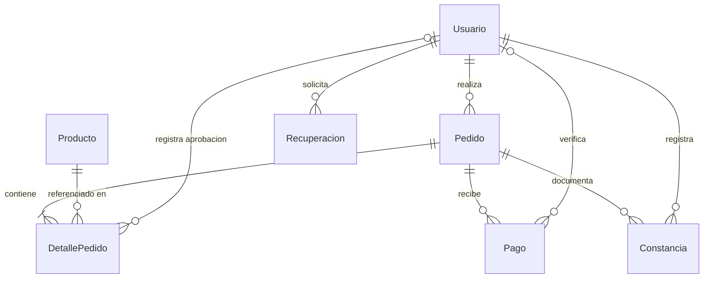
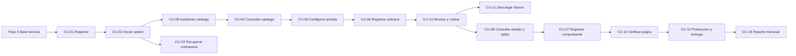

# Plan de construcción – Impacto Textil

> **Fuente única:** `docs/fase-1-y-2-ing-de-software.md`. No se usó ningún otro documento.
> **Convención de citas:** `F1 §x` = sección de la Fase 1; `F2 §x` = sección de la Fase 2 (artefactos UML y SRS); `P##` = pregunta de la entrevista (anexo de la Fase 1).
> **Marcado:** todo lo que diga **(propuesto)** no está en el documento; es una deducción que hay que confirmar (ver sección 5).
> **Supuesto general:** si la Fase 1 (F1 §4) y la SRS (F2 §5.3) dicen cosas distintas, en este plan manda la SRS, porque F2 §5.1 dice que “transforma los 16 RF y los 9 RNF de la Fase 1 en comportamientos verificables”. Esto falta confirmarlo (D-17).

---

## 1. Casos de uso principales

Prioridad del CU = la prioridad más alta de los RF que cubre (las prioridades de los RF salen de F2 §5.3).
Hay RNF **transversales** que se aplican a todos los CU y no se repiten en la tabla: RNF-01 (responsive, 320 px), RNF-04 (HTTPS), RNF-05 (concurrencia), RNF-06 (disponibilidad) y RNF-07 (repositorio y guía de despliegue).

| ID | Nombre (F2 §1.2) | Actor principal | HU | RF | RNF específicos | Prioridad |
|---|---|---|---|---|---|---|
| CU-01 | Registrar nueva cuenta | Visitante | HU-01 | RF-01 | RNF-03, RNF-08, RNF-09 | **Alta** |
| CU-02 | Iniciar sesión | Cliente / Administrador sin sesión | HU-02 | RF-02 | RNF-03, RNF-08 | **Alta** |
| CU-03 | Recuperar contraseña | Cliente / Administrador sin sesión (F2 §1.2) · Visitante (F2 §5.3) | HU-13 | RF-13 | RNF-03 | **Media** |
| CU-04 | Consultar catálogo de productos | Visitante, Cliente y Administrador | HU-03, HU-04 | RF-03 | RNF-08 | **Alta** |
| CU-05 | Configurar prenda y diseño | Cliente | HU-05, HU-06 | RF-04, RF-15 | RNF-02, RNF-04 (archivo privado) | **Alta** |
| CU-06 | Registrar solicitud de pedido | Cliente | HU-07 | RF-05 | RNF-08 | **Alta** |
| CU-07 | Registrar comprobante de pago | Cliente | HU-08 | RF-07 | RNF-04 (archivo privado) | **Alta** |
| CU-08 | Consultar estado y saldo | Cliente | HU-12 | RF-12 | RNF-04 (titularidad), RNF-08 | **Media** |
| CU-09 | Gestionar catálogo | Administrador | HU-14 | RF-14 | — | **Alta** |
| CU-10 | Revisar y cotizar pedidos | Administrador | HU-07, HU-09 | RF-06, RF-08 | — | **Alta** |
| CU-11 | Descargar archivo de diseño | Administrador | HU-10 | RF-09 | RNF-04 (acceso por rol) | **Alta** |
| CU-12 | Actualizar producción y entrega | Administrador (el Cliente confirma la entrega) | HU-11, HU-16 | RF-10, RF-11 (comprobación del anticipo) | — | **Alta** |
| CU-13 | Verificar y registrar pagos | Administrador | HU-08, HU-16 | RF-11, RF-07 (verificación) | RNF-04 (acceso a comprobantes) | **Alta** |
| CU-14 | Generar reporte mensual | Administrador | HU-15 | RF-16 | — | **Baja** |

Relaciones UML (F2 §1.2): CU-03 «extend» CU-02; CU-11 «extend» CU-10. CU-06 exige sesión previa (no es «include»).

---

## 2. Modelo de datos

### 2.1 Origen

Las tablas salen del diccionario de datos (F2 §4.1–4.6) y de las multiplicidades (F2 §3.2). El documento aclara que **no** define claves foráneas ni diseño relacional (F2 §3.1, F2 §4.6, F2 §5.1), así que todas las FK son **(propuestas)**. Los tipos SQL Server también son propuestos; se mapean así:

| Tipo lógico (F2 §4) | Tipo SQL Server (propuesto) |
|---|---|
| Integer (id) | `INT IDENTITY` |
| String máx. n | `NVARCHAR(n)` |
| Decimal C$ 2 decimales | `DECIMAL(10,2)` |
| Boolean | `BIT` |
| Date “ISO 8601 fecha y hora con zona” | `DATETIMEOFFSET` |
| Date “AAAA-MM-DD” | `DATE` |

“Sin definir” (antes de cotizar o aprobar) se guarda como `NULL`, nunca como 0 (F2 §4, intro).

### 2.2 Tablas

#### Usuario (F2 §4.1)

| Campo | Tipo | Nulo | Clave / restricción |
|---|---|---|---|
| id | INT IDENTITY | No | **PK** |
| nombre | NVARCHAR(100) | No | Letras, tildes, espacios, guiones, apóstrofos |
| correo | NVARCHAR(150) | No | **UNIQUE**; normalizado |
| passwordHash | NVARCHAR(100) | No | Hash BCrypt con sal (RNF-03) |
| rol | NVARCHAR(20) | No | CHECK IN ('Cliente','Administrador') |
| activo | BIT | No | Inactivo no inicia sesión |
| aceptacionTerminos | BIT | No | Debe ser 1 en registro público |
| fechaAceptacion | DATETIMEOFFSET | Sí | CHECK: obligatoria si aceptacionTerminos = 1 |

#### Producto (F2 §4.2)

| Campo | Tipo | Nulo | Clave / restricción |
|---|---|---|---|
| id | INT IDENTITY | No | **PK** |
| nombre | NVARCHAR(100) | No | No vacío |
| color | NVARCHAR(50) | No (ver D-42) | Opción vigente del negocio |
| talla | NVARCHAR(30) | No | Opción configurable |
| tela | NVARCHAR(100) | No | Opción vigente |
| imagenURL | NVARCHAR(2048) | Sí (ver D-42) | Solo imagen pública |
| precioBase | DECIMAL(10,2) | No | CHECK > 0; precio de referencia |
| activo | BIT | No | Desactivar ≠ borrar |

#### Pedido (F2 §4.3)

| Campo | Tipo | Nulo | Clave / restricción |
|---|---|---|---|
| id | INT IDENTITY | No | **PK** |
| usuarioId **(propuesto)** | INT | No | **FK → Usuario.id** (titular, rol Cliente) |
| codigo | NVARCHAR(50) | No | **UNIQUE** |
| fechaOrden | DATETIMEOFFSET | No | Se pone al confirmar el guardado |
| fechaEntregaAcordada | DATE | Sí | Obligatoria al confirmar la entrega |
| fechaEntregaReal | DATETIMEOFFSET | Sí | Obligatoria en Entregado |
| estado | NVARCHAR(20) | No | CHECK IN ('Pendiente','En producción','Listo para entrega','Entregado') |
| modalidadEntrega | NVARCHAR(10) | Sí (ver D-16) | CHECK IN ('Retiro','Domicilio') |
| direccionEntrega | NVARCHAR(250) | Sí | CHECK: obligatoria si Domicilio |
| totalReferencial | DECIMAL(10,2) | No | CHECK ≥ 0 |
| total | DECIMAL(10,2) | Sí | > 0 al aceptar; **derivado** |
| porcentajeAnticipo | DECIMAL(5,2) | Sí | CHECK IN (0, 30, 50) |
| anticipoExigible | DECIMAL(10,2) | Sí | **derivado** |
| saldoPendiente | DECIMAL(10,2) | Sí | CHECK ≥ 0; **derivado** |
| cotizacionAceptada | BIT | No | Valor inicial 0 |
| excepcionAnticipo | BIT | No | Valor inicial 0 |

#### DetallePedido (F2 §4.4)

| Campo | Tipo | Nulo | Clave / restricción |
|---|---|---|---|
| id | INT IDENTITY | No | **PK** |
| pedidoId **(propuesto)** | INT | No | **FK → Pedido.id** (composición) |
| productoId **(propuesto)** | INT | No | **FK → Producto.id** |
| aprobadorId **(propuesto)** | INT | Sí | **FK → Usuario.id** (Administrador); CHECK: obligatorio si disenoAprobado = 1 |
| cantidad | INT | No | CHECK > 0 |
| talla | NVARCHAR(30) | No | Copia histórica |
| color | NVARCHAR(50) | No | Copia histórica; no cambia |
| tela | NVARCHAR(100) | No | Copia histórica; no cambia |
| empaque | NVARCHAR(100) | No (ver D-42) | Opción del negocio |
| observaciones | NVARCHAR(1000) | Sí | Se muestra como texto, nunca se ejecuta |
| ideaDiseno | NVARCHAR(1000) | Sí | CHECK: ideaDiseno o archivoDisenoURL no nulo |
| archivoDisenoURL | NVARCHAR(2048) | Sí | Referencia privada; JPG/PNG ≤ 10 000 000 bytes |
| precioUnitarioAcordado | DECIMAL(10,2) | Sí | > 0 al cotizar |
| subtotal | DECIMAL(10,2) | Sí | **derivado** |
| disenoAprobado | BIT | No | Valor inicial 0 |
| fechaAprobacionDiseno | DATETIMEOFFSET | Sí | CHECK: obligatoria si disenoAprobado = 1 |

#### Pago (F2 §4.5)

| Campo | Tipo | Nulo | Clave / restricción |
|---|---|---|---|
| id | INT IDENTITY | No | **PK** |
| pedidoId **(propuesto)** | INT | No | **FK → Pedido.id** |
| verificadorId **(propuesto)** | INT | Sí | **FK → Usuario.id** (Administrador); CHECK: obligatorio si Verificado |
| monto | DECIMAL(10,2) | No | CHECK > 0 |
| fecha | DATETIMEOFFSET | No | Fecha del cobro externo |
| medio | NVARCHAR(15) | No | CHECK IN ('Efectivo','Transferencia','Depósito','Tarjeta') |
| referencia | NVARCHAR(100) | Sí | Obligatoria al verificar (CHECK) |
| estadoVerificacion | NVARCHAR(10) | No | CHECK IN ('Pendiente','Verificado','Rechazado') |
| comprobanteURL | NVARCHAR(2048) | Sí | Privada; JPG/PNG/PDF ≤ 10 000 000 bytes |
| fechaVerificacion | DATETIMEOFFSET | Sí | CHECK: obligatoria si Verificado |

Índice único para evitar duplicados **(propuesto)**: (pedidoId, medio, referencia) cuando referencia no es nula. Ver D-43.

#### Constancia (F2 §4.6, registro complementario)

| Campo | Tipo | Nulo | Clave / restricción |
|---|---|---|---|
| id **(propuesto)** | INT IDENTITY | No | **PK** (no aparece en el diccionario) |
| pedidoId **(propuesto)** | INT | No | **FK → Pedido.id** |
| tipo | NVARCHAR(25) | No | CHECK IN ('Cotización','Excepción de anticipo','Entrega') |
| decision | BIT | No | — |
| fecha | DATETIMEOFFSET | No | — |
| responsable | INT | No | **FK → Usuario.id** (Administrador) |
| referencia | NVARCHAR(250) | No | Versión de cotización o diseño |

#### Recuperación (F2 §4.6, registro complementario)

| Campo | Tipo | Nulo | Clave / restricción |
|---|---|---|---|
| id **(propuesto)** | INT IDENTITY | No | **PK** (no aparece en el diccionario) |
| usuario | INT | No | **FK → Usuario.id** |
| tokenHash | NVARCHAR(?) | No | **UNIQUE (propuesto)**; nunca guardar el token en claro |
| fechaEmision | DATETIMEOFFSET | No | — |
| fechaExpiracion | DATETIMEOFFSET | No | CHECK > fechaEmision |
| usado | BIT | No | Valor inicial 0 |

### 2.3 Relaciones

| Relación | Multiplicidad | Implementación (propuesta) | Fuente |
|---|---|---|---|
| Usuario – Pedido | 1 — 0..* | Pedido.usuarioId | F2 §3.2 |
| Pedido ◆ DetallePedido | 1 — 1..* (composición) | DetallePedido.pedidoId; el “mínimo 1” se valida en la transacción de CU-06 | F2 §3.2 |
| Producto – DetallePedido | 1 — 0..* | DetallePedido.productoId | F2 §3.2 |
| Pedido – Pago | 1 — 0..* | Pago.pedidoId | F2 §3.2 |
| Usuario (Admin) – Pago | 0..1 — 0..* | Pago.verificadorId (nulo si está Pendiente) | F2 §3.2 |
| Usuario (Admin) – DetallePedido | 0..1 — 0..* | DetallePedido.aprobadorId | F2 §3.2 |
| Pedido – Constancia | 1 — 0..* | Constancia.pedidoId | F2 §4.6 |
| Usuario (Admin) – Constancia | 1 — 0..* | Constancia.responsable | F2 §4.6 |
| Usuario – Recuperación | 1 — 0..* | Recuperación.usuario | F2 §4.6 |

- No se borra nada físicamente (se usa `activo`), así que todas las FK van con `ON DELETE NO ACTION`.
- Una FK no puede garantizar el rol (“debe ser Cliente” o “debe ser Administrador”). Eso lo valida la API.

*(En el diagrama se escribe “Recuperacion” sin tilde solo para que Mermaid lo pueda dibujar; ver D-22.)*

### 2.4 Verificación de 3FN

- **1FN:** todos los campos guardan un solo valor. Se cumple **solo si** cada fila de Producto es una variante (una talla, un color, una tela). Si un producto debe tener varias tallas o colores y se guardan juntos en un mismo campo, se rompe la 1FN (ver D-20).
- **2FN:** todas las PK son simples (un solo campo `id`), así que no puede haber dependencias parciales. **Se cumple.**
- **3FN:** hay dependencias transitivas o datos redundantes:

| # | Campo | Depende de | ¿Cumple 3FN? | Observación |
|---|---|---|---|---|
| 1 | DetallePedido.subtotal | cantidad × precioUnitarioAcordado (no son clave) | **No** | Dependencia transitiva dentro de la misma fila |
| 2 | Pedido.anticipoExigible | total × porcentajeAnticipo / 100 | **No** | Dependencia transitiva dentro de la misma fila |
| 3 | Pedido.total | Suma de DetallePedido.subtotal | No (redundancia) | Se calcula con datos de otra tabla y se puede desincronizar |
| 4 | Pedido.saldoPendiente | total − suma de Pago.monto Verificados | **No** | Depende de `total` (no es clave) y de otra tabla |
| 5 | Pedido.porcentajeAnticipo y excepcionAnticipo | excepcionAnticipo = 1 obliga a porcentaje = 0 | **No** | Un campo no clave determina a otro |
| 6 | Pedido.cotizacionAceptada y excepcionAnticipo | Repiten lo que ya dice Constancia (tipo + decision) | No (redundancia entre tablas) | Riesgo de que digan cosas distintas |
| 7 | DetallePedido.talla / color / tela | Copian lo de Producto | Parece que no, pero **está justificado** | Son una “foto” histórica que exige F2 §3.3 regla 11; son datos del pedido, no del producto |
| 8 | Producto.nombre / precioBase / imagenURL | Si Producto es una variante, es probable que dependan del tipo de camiseta y no de la variante | **No, si se modela por variante** | Ver D-20 |

**Propuesta para decidir (D-40):** mantener los nombres del diccionario y hacer que la BD sea la que garantice la coherencia:
- (1) y (2) como **columnas calculadas** de SQL Server.
- (3) y (4) guardadas, pero **recalculadas dentro de la misma transacción**, como pide F2 §1.3 CU-13 en el paso 4.
- (5) y (6) con CHECK y reglas de servicio.

La otra opción es quitarlas de las tablas y calcularlas en vistas.

---

## 3. Orden de construcción

Se trabaja un CU a la vez y de punta a punta: **BD → API → pantalla → prueba**. Las rutas de la API y las pantallas son **(propuestas)**, porque el documento no las define (F2 §5.1: “no desarrolla código, pantallas ni base de datos”). Las pruebas usan los **criterios de aceptación de F2 §5.3**.

> [!WARNING]
> El Hito 3 (diseño, código y defensa) es la semana del 04 al 07 de noviembre de 2026 (F1 §1.8), y F2 §5.5 dice que las fechas hay que confirmarlas (D-44). Por eso los CU de prioridad Media y Baja que no bloquean a otros (CU-03 y CU-14) van al final.

### Paso 0 – Base técnica (no es un CU)
Solución .NET Web API con EF Core y DbContext. Cadena de conexión en variable de entorno o archivo ignorado por git. HTTPS obligatorio (RNF-04). Manejo global de errores con mensajes genéricos para el usuario. Hoja CSS base responsive (RNF-01). Carpeta `/database` para los scripts.

### 1. CU-01 Registrar nueva cuenta
- **Depende de:** Paso 0.
- **BD:** tabla `Usuario`.
- **API:** `POST /api/auth/registro`. Siempre asigna el rol Cliente e ignora cualquier rol que mande el cliente.
- **Pantalla:** PAN-01 Registro, con la casilla obligatoria de aviso de privacidad y términos (RNF-09).
- **Prueba (RF-01):** crear una cuenta válida y comprobar que tiene rol Cliente y consentimiento con fecha. Rechazar un correo repetido y una solicitud con rol administrativo. Revisar en la BD que solo hay hashes BCrypt (RNF-03).
- **Bloquea:** D-24.

### 2. CU-02 Iniciar sesión
- **Depende de:** CU-01.
- **BD:** `Usuario` (solo lectura) y script de datos de prueba con el primer Administrador (D-26).
- **API:** `POST /api/auth/login`. Crea la sesión con la identidad y el rol de la cuenta.
- **Pantalla:** PAN-02 Inicio de sesión.
- **Prueba (RF-02):** credenciales válidas dan acceso a las funciones del rol. Credenciales incorrectas, una cuenta inexistente o una cuenta inactiva no dan acceso, y el mensaje no revela si la cuenta existe.
- **Bloquea:** D-26, D-31.

### 3. CU-09 Gestionar catálogo
- **Depende de:** CU-02 (rol Administrador).
- **BD:** tabla `Producto`.
- **API:** `GET/POST/PUT /api/admin/productos` y `PATCH /api/admin/productos/{id}/desactivar`.
- **Pantalla:** PAN-10 Gestión de catálogo.
- **Prueba (RF-14):** actualizar un precio y desactivar un producto: el producto ya no se puede elegir. La parte de “conservar el precio acordado de un pedido existente” se vuelve a probar después de CU-10.
- **Bloquea:** D-06, D-19, D-20, D-30.

### 4. CU-04 Consultar catálogo de productos
- **Depende de:** CU-09 (necesita productos).
- **BD:** `Producto` (solo los activos).
- **API:** `GET /api/productos` y `GET /api/productos/{id}`.
- **Pantalla:** PAN-05 Catálogo y PAN-06 Detalle de producto.
- **Prueba (RF-03):** se ven solo los productos activos y los precios aparecen como “de referencia”. Un catálogo vacío muestra un aviso. Sin scroll horizontal a 320 px (RNF-01).
- **Bloquea:** D-20.

### 5. CU-05 Configurar prenda y diseño
- **Depende de:** CU-02 y CU-04.
- **BD:** depende de cómo se guarde el carrito (D-18). El archivo se guarda en almacenamiento privado (D-30).
- **API:** subida del diseño con validación del formato real y del tamaño. Operaciones del carrito según D-18.
- **Pantalla:** formulario de configuración en PAN-06 y PAN-07 Carrito.
- **Prueba (RF-04, RF-15):** aceptar un JPG/PNG válido de 10 000 000 bytes. Rechazar uno de 10 000 001 bytes y uno con extensión falsa, sin perder lo demás que se escribió. Aceptar una idea sin archivo. Guardar tela, empaque, idea y observaciones. RNF-02: procesamiento en menos de 3 s de media.
- **Bloquea:** D-07, D-15, D-18, D-19, D-30.

### 6. CU-06 Registrar solicitud de pedido
- **Depende de:** CU-05.
- **BD:** tablas `Pedido` y `DetallePedido`.
- **API:** `POST /api/pedidos`. En una sola transacción: valida, calcula totalReferencial, genera el código único, guarda el estado Pendiente y, si algo falla, revierte todo.
- **Pantalla:** PAN-07 Carrito y confirmación (muestra el código).
- **Prueba (RF-05):** registrar al menos un detalle válido y obtener un código único. Forzar un fallo de guardado y comprobar que no queda un pedido a medias ni se pierde el carrito. Un precio cambiado pide confirmar otra vez.
- **Bloquea:** D-16, D-18, D-21, D-28.

### 7. CU-10 Revisar y cotizar pedidos
- **Depende de:** CU-06.
- **BD:** tabla `Constancia` y uso de los campos de cotización de `Pedido` y `DetallePedido`.
- **API:** `GET /api/admin/pedidos` (con filtros), `GET /api/admin/pedidos/{id}`, y registro de cotización, aceptación, aprobación del diseño, acuerdo de entrega y anticipo o excepción.
- **Pantalla:** PAN-11 Lista de pedidos y PAN-12 Detalle del pedido.
- **Prueba (RF-06, RF-08):** 2 prendas a C$100 + 1 a C$150 dan un total de C$350, y cambiar el precio del catálogo no altera ese total. Se registran cotización aceptada, fecha y aprobación. Un cambio de diseño exige una nueva aprobación. Pedir un cambio de tela o color se rechaza.
- **Bloquea:** D-05, D-23, D-29, D-33, D-39, D-40.

### 8. CU-11 Descargar archivo de diseño
- **Depende de:** CU-10 (lo extiende).
- **BD:** `DetallePedido.archivoDisenoURL` (solo lectura).
- **API:** `GET /api/admin/detalles/{id}/archivo`, con control de rol.
- **Pantalla:** botón dentro de PAN-12.
- **Prueba (RF-09):** el archivo descargado es idéntico al original (se compara su hash). Un usuario sin permiso no lo obtiene. Si el detalle solo tiene una idea, se avisa que no hay archivo.
- **Bloquea:** D-30.

### 9. CU-08 Consultar estado y saldo
- **Depende de:** CU-10. Va antes de CU-07 porque CU-07 necesita la pantalla “mis pedidos”.
- **BD:** `Pedido` (lectura filtrada por titular).
- **API:** `GET /api/mis-pedidos` y `GET /api/mis-pedidos/{codigo}`, validando la titularidad.
- **Pantalla:** PAN-08 Mis pedidos y PAN-09 Detalle de mi pedido.
- **Prueba (RF-12):** dos clientes ven solo sus propios pedidos, y cambiar el código en la URL no muestra datos ajenos. Lo que aún no está acordado aparece como “pendiente”, no como 0. Se vuelve a probar después de CU-13 y CU-12.
- **Bloquea:** D-41.

### 10. CU-07 Registrar comprobante de pago
- **Depende de:** CU-08.
- **BD:** `Pago` con estadoVerificacion = Pendiente.
- **API:** `POST /api/mis-pedidos/{codigo}/comprobantes`. Valida JPG/PNG/PDF de hasta 10 000 000 bytes y la titularidad.
- **Pantalla:** formulario dentro de PAN-09.
- **Prueba (RF-07):** el administrador ve la evidencia. Subirla no cambia el saldo. Los comprobantes de pedidos ajenos no son accesibles.
- **Bloquea:** D-30, D-35.

### 11. CU-13 Verificar y registrar pagos
- **Depende de:** CU-10 (cotización aceptada) y CU-07.
- **BD:** `Pago` (verificadorId, fechaVerificacion) y `Pedido.saldoPendiente`.
- **API:** listar los pagos de un pedido, registrar un cobro verificado y verificar o rechazar una evidencia. Todo en una transacción que controle la concurrencia.
- **Pantalla:** PAN-13 Pagos del pedido.
- **Prueba (RF-11):** con un total de C$1000, el anticipo unitario es C$300. Pagos verificados de C$300 y C$200 dejan un saldo de C$500. Un pago Pendiente no cambia el saldo. Se rechazan un pago duplicado y un cobro mayor que C$500. Dos verificaciones simultáneas nunca dejan el saldo negativo.
- **Bloquea:** D-35, D-40, D-43.

### 12. CU-12 Actualizar producción y entrega
- **Depende de:** CU-10 y CU-13.
- **BD:** `Pedido.estado`, `Pedido.fechaEntregaReal` y `Constancia` de tipo Entrega.
- **API:** `PUT /api/admin/pedidos/{id}/estado`. Solo acepta la secuencia válida y comprueba las condiciones.
- **Pantalla:** acción dentro de PAN-12. El cliente ve el resultado en PAN-09.
- **Prueba (RF-10):** se bloquea el inicio de producción si falta el anticipo o la excepción autorizada. La secuencia completa funciona y el cliente ve el mismo estado. Se rechazan los saltos de estado y marcar Entregado sin confirmación.
- **Bloquea:** D-08, D-36, D-37, D-38.

### 13. CU-03 Recuperar contraseña
- **Depende de:** CU-02.
- **BD:** tabla `Recuperación`.
- **API:** solicitar la recuperación (respuesta neutral) y restablecer con el token.
- **Pantalla:** PAN-03 Solicitar recuperación, PAN-04 Restablecer contraseña y un enlace en PAN-02.
- **Prueba (RF-13):** la primera respuesta no revela si la cuenta existe. Un token válido funciona una sola vez, y uno usado o vencido falla. Después de restablecer no se inicia sesión automáticamente.
- **Bloquea:** D-10, D-25.

### 14. CU-14 Generar reporte mensual
- **Depende de:** CU-12 y CU-13.
- **BD:** `Pedido` y `Pago` (solo lectura).
- **API:** `GET /api/admin/reportes/mensual?anio=&mes=`.
- **Pantalla:** PAN-14 Reporte mensual.
- **Prueba (RF-16):** un pedido entregado en octubre con un anticipo cobrado en septiembre cuenta en los entregados de octubre y en los ingresos de septiembre. Un mes sin registros muestra 0.

### Cierre – Pruebas transversales
RNF-01 (320 px), RNF-04 (100 % HTTPS y acceso a archivos ajenos denegado), RNF-05 (50 usuarios, respuestas de 2 s o menos), RNF-06 (medición durante un mes), RNF-07 (desplegar con la guía en menos de 1 h), RNF-08 (navegadores indicados), RNF-09 (revisión legal en un documento aparte).

---

## 4. Trazabilidad

### 4.1 Pantallas (propuestas)

| ID | Pantalla | CU |
|---|---|---|
| PAN-01 | Registro | CU-01 |
| PAN-02 | Inicio de sesión | CU-02, CU-03 (enlace) |
| PAN-03 | Solicitar recuperación | CU-03 |
| PAN-04 | Restablecer contraseña | CU-03 |
| PAN-05 | Catálogo | CU-04 |
| PAN-06 | Detalle de producto y configuración | CU-04, CU-05 |
| PAN-07 | Carrito y confirmación de solicitud | CU-05, CU-06 |
| PAN-08 | Mis pedidos | CU-08 |
| PAN-09 | Detalle de mi pedido (estado, fecha, saldo y comprobante) | CU-08, CU-07 |
| PAN-10 | Admin – Gestión de catálogo | CU-09 |
| PAN-11 | Admin – Lista de pedidos con filtros | CU-10 |
| PAN-12 | Admin – Detalle del pedido (cotización, aprobaciones, descarga, estado) | CU-10, CU-11, CU-12 |
| PAN-13 | Admin – Pagos del pedido | CU-13 |
| PAN-14 | Admin – Reporte mensual | CU-14 |

### 4.2 Matriz CU – RF – tablas – pantallas

| CU | HU | RF | RNF específicos | Tablas (L = lectura, E = escritura) | Pantallas |
|---|---|---|---|---|---|
| CU-01 | HU-01 | RF-01 | RNF-03, 08, 09 | Usuario (E) | PAN-01 |
| CU-02 | HU-02 | RF-02 | RNF-03, 08 | Usuario (L) | PAN-02 |
| CU-03 | HU-13 | RF-13 | RNF-03 | Usuario (L/E), Recuperación (E) | PAN-02, 03, 04 |
| CU-04 | HU-03, 04 | RF-03 | RNF-08 | Producto (L) | PAN-05, 06 |
| CU-05 | HU-05, 06 | RF-04, RF-15 | RNF-02, 04 | Producto (L); carrito (D-18) | PAN-06, 07 |
| CU-06 | HU-07 | RF-05 | RNF-08 | Producto (L), Pedido (E), DetallePedido (E) | PAN-07 |
| CU-07 | HU-08 | RF-07 | RNF-04 | Pedido (L), Pago (E) | PAN-09 |
| CU-08 | HU-12 | RF-12 | RNF-04, 08 | Pedido (L) | PAN-08, 09 |
| CU-09 | HU-14 | RF-14 | — | Producto (E) | PAN-10 |
| CU-10 | HU-07, 09 | RF-06, RF-08 | — | Pedido (E), DetallePedido (E), Constancia (E) | PAN-11, 12 |
| CU-11 | HU-10 | RF-09 | RNF-04 | DetallePedido (L) | PAN-12 |
| CU-12 | HU-11, 16 | RF-10, RF-11 | — | Pedido (E), Constancia (L/E), DetallePedido (L), Pago (L) | PAN-12, 09 |
| CU-13 | HU-08, 16 | RF-11, RF-07 | RNF-04 | Pago (E), Pedido (E), Constancia (L) | PAN-13 |
| CU-14 | HU-15 | RF-16 | — | Pedido (L), Pago (L) | PAN-14 |

Cobertura: los 16 RF están cubiertos (igual que en F2 §5.6). Los RNF transversales (01, 04, 05, 06, 07) se aplican a todos los CU.

---

## 5. Dudas y contradicciones

### 5.1 Contradicciones dentro del documento

| ID | Tema | Qué no cuadra | Sección | Qué hay que decidir |
|---|---|---|---|---|
| D-01 | Número de RNF | F2 §5.1 habla de “9 RNF de la Fase 1”, pero la Fase 1 solo tiene RNF-01 a RNF-06. RNF-07, 08 y 09 aparecen por primera vez en F2 §5.4 | F1 §4, F2 §5.1, F2 §5.4 | ¿Se toman los 9 de F2 §5.4 como vigentes? |
| D-02 | RNF-04 | En F1 es “Legal: Ley 787 (términos y SSL)”. En F2 es “Seguridad: HTTPS + acceso por rol y titularidad”, y lo legal pasa a RNF-09 | F1 §4, F2 §5.4 | Confirmar la numeración de F2 |
| D-03 | RNF-02 | En F1 se mide la subida completa, incluida la red (“Network tab”). En F2 solo el procesamiento en el servidor, sin contar la transferencia | F1 §4, F2 §5.4 | ¿Qué medición vale? |
| D-04 | RNF-05 / RNF-06 | RNF-05: “sin degradación” (F1) frente a “≤ 2 s” (F2). RNF-06: categoría “Disponibilidad” frente a “Rendimiento (disponibilidad)” | F1 §4, F2 §5.4 | Confirmar los criterios de F2 |
| D-05 | Fórmula de RF-06 | En F1 el total es “Precio Base × Cantidad” en el carrito. En F2 es cantidad × precio unitario cotizado en CU-10 | F1 §4, F2 §5.3 | Supongo que el de F1 corresponde a totalReferencial. ¿Correcto? |
| D-06 | RF-14 | F1 dice “CRUD completo”. F2 dice gestionar “sin eliminar referencias” y desactivar | F1 §4, F2 §5.3 | ¿Se pueden **eliminar** productos que nunca se usaron, o solo desactivarlos? |
| D-07 | Formatos de diseño | F1 §1.4 habla de “imágenes/vectores” y “fotográfico/vectorial”. RF-04 solo admite JPG/PNG | F1 §1.4, F1 §4, F2 §5.3 | ¿Se excluyen los archivos vectoriales? |
| D-08 | Estados | F1 §1.2 lista 3 estados (“Pendiente, En Producción, Listo para Entrega”). F2 tiene 4 (añade Entregado) y otra mayúscula (“En producción”) | F1 §1.2, F2 §3.3, F2 §4.3 | Usaré los 4 de F2 §4.3. ¿Correcto? |
| D-09 | Anticipo del 0 % | F1 solo menciona 30 % y 50 %. F2 añade el 0 % por excepción (que sí sale en P29) | F1 §1.4, F1 §4, F2 §3.3 | Confirmar el 0 % |
| D-10 | Actor de CU-03 | F2 §1.2: “Cliente / Administrador sin sesión”. F2 §1.1 y RF-13: “Visitante” | F2 §1.1, F2 §1.2, F2 §5.3 | ¿Puede recuperar la contraseña un Administrador? |
| D-11 | Infraestructura | F2 §2.1 dice SQL Server, pero F1 §2.2 y §1.9 proponen Supabase/Azure SQL Edge, Vercel/Netlify y Azure/Render, y el RNF-06 de F1 cita Azure/Render. AGENTS.md fija **Somee** | F1 §1.9, F1 §2.1, F1 §2.2, F1 §4 | Confirmar Somee + SQL Server y que RNF-06 se mida en Somee |
| D-12 | Costo | F1 §2.2: C$55 al mes. Conclusión de F1: “costo operativo mensual a cero” | F1 §2.2, F1 Conclusión | No afecta la construcción |
| D-13 | Nombre de tabla | El criterio de RF-03 habla de la “tabla Productos”; la entidad se llama “Producto” | F1 §4, F2 §4.2 | Usaré `Producto` |
| D-14 | “Tipo de cuello” | Aparece como especificación en F1 §1.2, pero no está en el diccionario | F1 §1.2, F2 §4.4 | No lo construyo salvo que me indiques lo contrario |
| D-15 | Carrito sin sesión | CU-05 exige un cliente autenticado, pero CU-06 dice “si no hay sesión… conservar el carrito” | F2 §1.3 | ¿Se refiere solo a una sesión que expiró? |
| D-16 | modalidadEntrega | RF-05 y CU-06 la piden al registrar la solicitud. F2 §4.3 la marca “obligatoria al confirmar entrega” y CU-10 la acuerda después | F2 §1.3, F2 §4.3, F2 §5.3 | ¿Es obligatoria en CU-06 o puede quedar NULL hasta CU-10? |
| D-17 | Redacción F1 frente a F2 | Las citas “Requerimiento de la Fase 1” de F2 §5.3 no coinciden con F1 §4 (RF-01 añade el nombre, RF-12 añade la fecha acordada, RF-15 añade tela, empaque e idea, etc.) | F1 §4, F2 §5.3 | ¿Manda F2 §5.3 en todos los casos? |

### 5.2 Datos que faltan

| ID | Tema | Qué falta | Sección | Bloquea |
|---|---|---|---|---|
| D-18 | Carrito | No hay entidad Carrito. No se sabe si vive en el navegador o en el servidor, ni dónde queda el archivo de diseño antes de que exista el Pedido (un DetallePedido no puede existir sin Pedido) | F2 §1.3 CU-05/06, F2 §4.6 | CU-05, CU-06 |
| D-19 | Opciones de talla, color, tela y empaque | Se habla de “opciones del catálogo / acordadas / del negocio”, pero no hay una tabla para ellas. El empaque (bolsa estándar o caja premium, P4 y P19) no está en Producto. ¿El empaque cambia el precio de referencia? | F2 §3.3 regla 2, F2 §4.2, F2 §4.4 | CU-05, CU-09 |
| D-20 | Producto: ¿variante o tipo? | Producto tiene una sola talla, un solo color y una sola tela, pero RF-03 habla de “tallas, colores” y HU-14 de “productos y colores”. ¿Cada fila es una combinación? Esto afecta a la 3FN (punto 8 de 2.4) | F2 §3.1, F2 §4.2, F1 §3 | CU-09, CU-04 |
| D-21 | totalReferencial | La SRS no da la fórmula. Propuesta: suma de precioBase × cantidad | F2 §4.3, F2 §1.3 CU-06 | CU-06 |
| D-22 | Nombres de FK y PK | El diccionario no nombra las FK de Pedido, DetallePedido y Pago, ni el `id` de Constancia y Recuperación. Constancia usa `responsable` y Recuperación usa `usuario`. “Recuperación” lleva tilde, lo que complica los identificadores en SQL y C# | F2 §4.6 | Todas las tablas |
| D-23 | Umbral de gran volumen | No está definido, igual que la política para pedidos intermedios. Propuesta: que el Administrador elija 30, 50 o 0 % a mano, sin clasificación automática | F2 §3.3 regla 5, F2 §5.5 | CU-10, CU-13 |
| D-24 | Política de contraseña | Hay que validarla antes de implementar | F2 §4.1, F2 §5.5 | CU-01, CU-03 |
| D-25 | Token y correo | No está fijado cuánto dura el token. Tampoco qué servicio de correo envía el enlace ni sus credenciales | F2 §4.6, F2 §5.3 RF-13 | CU-03 |
| D-26 | Primer Administrador | Se habla de “asignación controlada”, pero no hay CU para crear administradores. ¿Se crea con un script de datos? | F2 §1.1, F2 §3.3 regla 1 | CU-02 |
| D-27 | Usuario.activo | Ningún CU activa o desactiva cuentas | F2 §4.1 | — |
| D-28 | Código de pedido | Solo se dice “alfanumérico” y máximo 50 caracteres; no hay formato | F1 §4 RF-05, F2 §4.3 | CU-06 |
| D-29 | Filtros de RF-08 | F1 dice “por estado”; F2 no especifica | F1 §4, F2 §5.3 | CU-10 |
| D-30 | Almacenamiento de archivos | No se dice dónde se guardan los diseños y comprobantes privados (disco del servidor o BD) ni con qué límites. Para la imagen del catálogo no se sabe si es una subida o una URL, ni su formato y tamaño | F2 §4.2, §4.4, §4.5 | CU-05, 07, 09, 11 |
| D-31 | Sesión | “Sesión segura” sin mecanismo definido (cookie o token) ni tiempo de expiración. Tampoco hay un CU de **cerrar sesión** | F2 §1.3 CU-02, F2 §2.1 | CU-02 |
| D-32 | CU sin narrativa | CU-01, 03, 04, 07, 08, 09, 11 y 14 solo tienen su RF en F2 §5.3, sin flujo propio | F2 §1.3 | — |
| D-33 | Versiones de diseño y cotización | Se habla de “versión vigente” y “nueva cotización”, pero no hay campos de versión. ¿Se sobrescriben archivoDisenoURL y precioUnitarioAcordado y el historial queda en Constancia.referencia? ¿Quién sube la nueva versión del diseño? | F2 §1.3 CU-10, F2 §3.3 regla 9, F2 §4.6 | CU-10 |
| D-34 | Cancelación | No hay estado ni flujo para cancelar. Una cotización no aceptada se queda en Pendiente para siempre | F2 §1.3 CU-10, F2 §4.3 | — |

### 5.3 Ambigüedades

| ID | Tema | Duda | Sección | Bloquea |
|---|---|---|---|---|
| D-35 | CU-07 frente a CU-13 | ¿CU-13 verifica el Pago Pendiente creado en CU-07 o crea un pago nuevo? ¿Cómo se marca Rechazado? ¿Se puede subir un comprobante antes de que la cotización esté aceptada? | F2 §1.3 CU-13, F2 §4.5, F2 §5.3 RF-07 | CU-07, CU-13 |
| D-36 | Confirmación de entrega | ¿El cliente la marca en el sistema, o el Administrador la registra como Constancia de tipo Entrega? | F2 §1.3 CU-12, F2 §4.6 | CU-12 |
| D-37 | “Antes de sublimar” | No hay un estado de sublimación. ¿La aprobación del diseño solo se comprueba al pasar a En producción? | F2 §1.3 CU-12 paso 4, F2 §3.3 regla 9 | CU-12 |
| D-38 | Entrega con saldo | ¿Se puede marcar Entregado con saldoPendiente mayor que 0? (F2 §3.3 regla 10 solo dice que el saldo “se conserva”) | F2 §3.3 regla 10 | CU-12 |
| D-39 | Aprobación del diseño | Los tipos de Constancia no incluyen el diseño, pero el texto pide vincular el diseño vigente a su aprobación | F2 §4.6 | CU-10 |
| D-40 | Campos derivados y 3FN | AGENTS.md exige 3FN, pero el diccionario incluye subtotal, total, anticipoExigible y saldoPendiente, y algunos booleanos repiten lo de Constancia (ver 2.4) | F2 §4.3, F2 §4.4 | CU-10, CU-13 |
| D-41 | Notificaciones | La épica de HU-12 se llama “Notificaciones” y F1 §1.3 habla de “tiempo real”, pero RF-12 solo es consulta. Supongo que no hay avisos automáticos | F1 §1.3, F1 §3, F2 §5.3 | CU-08 |
| D-42 | Campos obligatorios | Producto.color, Producto.imagenURL y DetallePedido.empaque no dicen si son obligatorios (talla y tela sí) | F2 §4.2, F2 §4.4 | CU-05, CU-09 |
| D-43 | Pagos duplicados | Se pide “contrastar medio, referencia, pedido y evidencia”. Para efectivo se usa una “constancia interna” sin formato definido | F2 §4.5 | CU-13 |
| D-44 | Plazo | Hito 3 del 04 al 07 de noviembre de 2026, y F2 §5.5 dice que las fechas de la guía y del plan difieren | F1 §1.8, F2 §5.5 | Planificación |
